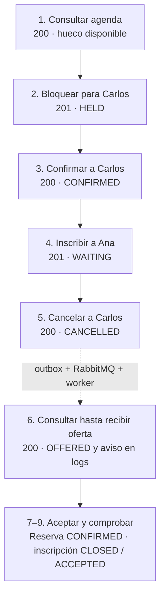

# Citación de pruebas diagnósticas

API para la [prueba técnica de arquitectura de software](docs/diagnostic-appointment-requirements.pdf).
Permite consultar la agenda, bloquear un hueco, confirmar o cancelar citas y
gestionar una lista de espera con ofertas asíncronas. Solo utiliza datos sintéticos.

La **API** atiende las peticiones y el **worker** procesa caducidades, ofertas y
avisos. PostgreSQL garantiza la exclusividad de los huecos, incluso con peticiones
concurrentes; RabbitMQ comunica las liberaciones y los avisos.

- [Arranque y comandos Docker](#arranque-y-comandos-docker)
- [Tecnologías escogidas](#tecnologías-escogidas)
- [Recorrido de prueba](#recorrido-de-prueba)
- [Respuestas al enunciado](#respuestas-al-enunciado)
- [Desarrollo de la práctica](#desarrollo-de-la-práctica)
- [Verificación](#verificación)
- [Documentación de referencia](#documentación-de-referencia)

## Arranque y comandos Docker

Necesitas Docker en ejecución y Docker Compose con soporte de `--wait`.
Desde la raíz del repositorio, sin instalar Node:

```bash
docker compose up --build --wait

# Comprueba que la API está preparada; esperado: HTTP 200.
curl --fail --include http://127.0.0.1:3000/health/ready
```

Levanta API, worker, PostgreSQL y RabbitMQ en segundo plano y espera a que estén
saludables. Abre [Swagger UI](http://127.0.0.1:3000/docs) para probar las operaciones;
el contrato está en [OpenAPI JSON](http://127.0.0.1:3000/openapi.json).

| Comando | Para qué sirve |
| --- | --- |
| `docker compose ps` | Ver el estado y los puertos. |
| `docker compose logs --tail=50 -f api worker` | Seguir peticiones y avisos; salir con `Ctrl+C`. |
| `docker compose stop` | Parar conservando contenedores y datos. |
| `docker compose up -d --wait` | Volver a levantar la demo con sus datos. |
| `docker compose down` | Eliminar contenedores y redes, conservando volúmenes. |
| `docker compose down --volumes` | Parar y **borrar todos los datos y mensajes**. |

La agenda se crea para el día siguiente y conserva sus fechas entre arranques.
Si los huecos ya han pasado o quieres empezar de cero, ejecuta
`docker compose down --volumes` y vuelve a arrancar. Se recrean juntos los dos
almacenes; los volúmenes persistentes no sustituyen un backup.

## Tecnologías escogidas

| Tecnología | Motivo |
| --- | --- |
| Node.js y TypeScript | Código compartido entre API y worker, con estados y contratos explícitos. |
| Fastify | HTTP, validación de entradas y esquemas de respuesta. |
| PostgreSQL | Transacciones, bloqueos y restricciones para resolver concurrencia. |
| RabbitMQ | Mensajería asíncrona real entre liberación y aviso. |
| OpenAPI y Swagger UI | Contrato e interfaz de prueba generados desde los esquemas HTTP. |
| Vitest | Pruebas unitarias y de integración. |
| Docker Compose | Demo completa con un solo comando. |

## Recorrido de prueba

Carlos reserva y confirma el único hueco de `hospital-south/mri`. Ana entra en
espera; Carlos cancela y el worker ofrece el hueco a Ana, que lo acepta.



<details>
<summary>Ejecutar el recorrido con curl (9 pasos)</summary>

Parte de una demo recién creada y ejecuta los pasos **uno a uno**. Sustituye
`SLOT_ID` por el `id` del hueco, `CARLOS_RESERVATION_ID` y `ANA_ENTRY_ID` por los
IDs de las creaciones y `ANA_OFFER_ID` por el `offer.id` del paso 6.
`--include` muestra el código HTTP junto a la respuesta.

```bash
# 1. Consulta la agenda; esperado: 200 y un hueco con directlyBookable: true.
curl --fail --include --get http://127.0.0.1:3000/slots \
  --data-urlencode hospitalId=hospital-south --data-urlencode testTypeId=mri \
  --data-urlencode from=2020-01-01T00:00:00Z --data-urlencode to=2100-01-01T00:00:00Z

# 2. Bloquea el hueco para Carlos; esperado: 201, state: HELD e id de su reserva.
curl --fail --include -X POST http://127.0.0.1:3000/slots/SLOT_ID/holds \
  -H 'X-Patient-Id: patient-carlos' -H 'Idempotency-Key: demo-carlos-hold'

# 3. Confirma antes de expiresAt; esperado: 200, mismo id y state: CONFIRMED.
curl --fail --include -X POST http://127.0.0.1:3000/reservations/CARLOS_RESERVATION_ID/confirm \
  -H 'X-Patient-Id: patient-carlos'

# 4. Inscribe a Ana al no quedar huecos libres; esperado: 201 y state: WAITING.
curl --fail --include -X POST http://127.0.0.1:3000/waiting-list-entries \
  -H 'X-Patient-Id: patient-ana' -H 'Idempotency-Key: demo-ana-entry' \
  -H 'Content-Type: application/json' \
  -d '{"hospitalId":"hospital-south","testTypeId":"mri"}'

# 5. Cancela antes de startsAt; esperado: 200 y reserva de Carlos CANCELLED.
curl --fail --include -X POST http://127.0.0.1:3000/reservations/CARLOS_RESERVATION_ID/cancel \
  -H 'X-Patient-Id: patient-carlos'

# 6. Consulta a Ana; esperado: 200. Repite hasta state: OFFERED y copia offer.id.
curl --fail --include http://127.0.0.1:3000/waiting-list-entries/ANA_ENTRY_ID \
  -H 'X-Patient-Id: patient-ana'

# Comprueba el aviso offer_notification con la misma reserva y expiresAt.
docker compose logs --tail=50 worker
```

El paso 6 puede mostrar `WAITING` mientras se procesa la liberación. Repite la
consulta y los logs hasta ver oferta y aviso. Acepta antes de `offer.expiresAt`:
hasta dos horas por defecto, limitado por el inicio del hueco.

```bash
# 7. Acepta la oferta de Ana; esperado: 200, mismo id y state: CONFIRMED.
curl --fail --include -X POST http://127.0.0.1:3000/reservations/ANA_OFFER_ID/confirm \
  -H 'X-Patient-Id: patient-ana'

# 8. Comprueba la cita de Ana; esperado: 200 y state: CONFIRMED.
curl --fail --include http://127.0.0.1:3000/reservations/ANA_OFFER_ID \
  -H 'X-Patient-Id: patient-ana'

# 9. Comprueba su inscripción; esperado: 200, CLOSED, closureReason: ACCEPTED, sin offer.
curl --fail --include http://127.0.0.1:3000/waiting-list-entries/ANA_ENTRY_ID \
  -H 'X-Patient-Id: patient-ana'
```

Resultado final: el mismo hueco, la reserva de Carlos `CANCELLED`, una reserva
nueva de Ana `CONFIRMED` y su inscripción cerrada por `ACCEPTED`. Repetir una
creación con su clave devuelve la respuesta histórica; los GET muestran el estado actual.

</details>

Las identidades de `X-Patient-Id` son sintéticas y **no autentican al paciente**.
Las creaciones requieren `Idempotency-Key`; guarda la clave antes del primer intento.
También puedes ejecutar los pasos desde Swagger UI, copiando los IDs de las respuestas.

## Respuestas al enunciado

### a. Decisiones y alternativas

- **Núcleo de reglas y adaptadores**, con API y worker separados. Se evitan
  repositorios CRUD genéricos y capas sin comportamiento que aportar.
- **Bloqueo breve por hospital/tipo y restricciones SQL** para impedir dobles
  asignaciones entre procesos. Se descartan mutex en memoria y un protocolo
  optimista más complejo para este alcance.
- **Outbox transaccional** para guardar negocio y evento juntos. Los reintentos
  se programan en PostgreSQL frente a colas TTL por cada espera, conservando
  presupuesto y auditoría junto a los efectos.

Los bloqueos caducan en un máximo de diez minutos. Las ofertas duran hasta dos
horas; ambos plazos se limitan al inicio del hueco y se revalidan al escribir.
La espera es FIFO entre pacientes elegibles del mismo hospital y tipo de prueba.
Si una oferta vence, se cierra esa inscripción y se pasa al siguiente; rechazarla
vigente conserva la antigüedad y excluye ese hueco.

### b. Qué queda fuera y por qué

Se priorizan citación, concurrencia y mensajería. Quedan fuera la interfaz de
pacientes, la administración de agendas, las integraciones clínicas y los avisos
SMS/email. Tampoco se implementan autenticación real, migraciones de bases
pobladas, despliegue productivo, alta disponibilidad, backup ni pruebas de carga.
La API, Swagger UI, el seed y los logs permiten revisar el ejercicio sin esas piezas.

### c. Garantías de mensajería

Entrega **al menos una vez**, con outbox, publicaciones confirmadas y reconocimiento
tras guardar el resultado del consumidor:

- **Pérdida o entrega incierta:** se reintentan publicaciones pendientes. Una
  pérdida física de un mensaje ya marcado como enviado requiere
  [recuperación manual](docs/operations.md#recuperación-manual). Los fallos de
  procesamiento se reintentan y, al agotar el presupuesto, quedan aparcados.
- **Duplicados:** el resultado persistido por evento/consumidor evita repetir
  efectos de negocio; el log de aviso sí puede repetirse.
- **Desorden:** se releen estado y plazos actuales; el FIFO lo decide PostgreSQL,
  no el orden de llegada de mensajes.

No se promete exactamente una vez ni un tiempo máximo de aviso. El log simula
el envío, sin acreditar recepción humana; una oferta puede vencer sin aviso útil.
Aceptar siempre revalida su vigencia.

### d. Datos de pacientes en un entorno real

El servicio conservaría solo los datos necesarios para gestionar citas, usando
referencias opacas y separando la información clínica y de contacto. Esas
referencias seguirían siendo información protegida. Sustituiría la identidad
simulada por autenticación real y autorización por paciente, función y hospital.

Aplicaría cifrado en tránsito y almacenamiento, gestión externa de secretos y
auditoría de accesos y cambios. Evitaría información clínica en mensajes, logs y
avisos, y protegería también outbox y DLQ. Acordaría con los responsables de
privacidad y seguridad los plazos de conservación y borrado, incluidos los de
copias de seguridad.

### e. Evolución a una red de hospitales

El modelo ya distingue hospitales, tipos de prueba y recursos. Antes de ampliarlo,
acordaría si las listas de espera y los recursos se comparten entre centros, cómo
se coordinan calendarios y prioridades clínicas y qué acceso corresponde a cada
hospital. También revisaría la antelación de las ofertas y el tratamiento de
quienes no recibieron un aviso utilizable.

Escalaría API y consumidores según la carga observada. El bloqueo actual serializa
las escrituras del mismo hospital y tipo de prueba: añadir instancias no elimina
esa contención. Mediría esperas y retrasos antes de cambiar esa coordinación.
Incorporaría alta disponibilidad de PostgreSQL y RabbitMQ, relevo automático del
publicador, alertas, restauraciones verificadas y migraciones compatibles con los
mensajes pendientes.

## Desarrollo de la práctica

Se ha utilizado **programación agéntica con dirección y revisión humana**:
definición funcional → diseño técnico → specs → tickets implementables con
criterios de aceptación.

La implementación se abordó con **TDD**: prueba que falla, implementación mínima
y refactorización. Las pruebas son la base para comprobar el trabajo de los
agentes y detectar regresiones; combinan unitarias e integraciones con PostgreSQL
y RabbitMQ reales, trazadas en la [matriz de aceptación](docs/acceptance.md).

## Verificación

Requiere Docker en ejecución, Compose con soporte de `--wait`, Node/pnpm y las
dependencias instaladas; consulta la
[configuración de desarrollo](docs/operations.md#configuración-y-desarrollo).
La demo puede permanecer activa:

```bash
pnpm typecheck
pnpm test
pnpm test:integration
pnpm build
```

Cada `pnpm test:integration` crea un proyecto Docker nuevo con PostgreSQL y
RabbitMQ propios, espera su disponibilidad y verifica la topología del broker
antes de ejecutar la suite. Usa puertos libres asignados por Docker y configura
las URLs automáticamente, sin compartir datos ni mensajes con la demo. Reutiliza
`compose.yaml`; no arranca los servicios API ni worker de Compose.

Al terminar elimina sus contenedores, red y volúmenes. Si falla, muestra estado y
logs antes de limpiar y conserva el código de salida fallido. La siguiente
ejecución comienza con almacenes nuevos. Las integraciones usan datos sintéticos
y cubren concurrencia, caducidades, FIFO, ofertas y fallos de transporte; tardan
varios minutos por las esperas reales de reintento. La CI utiliza el mismo comando,
con typecheck, unitarias y build separados. Los resultados locales y sus límites
están en la matriz de aceptación.

## Documentación de referencia

| Documento | Contenido |
| --- | --- |
| [Diseño funcional](docs/functional-design.md) | Reglas, ambigüedades resueltas y criterios de aceptación. |
| [Diseño técnico](docs/technical-design.md) | Módulos, transacciones, concurrencia y mensajería. |
| [Referencia de API y operación](docs/operations.md) | Contrato HTTP, configuración, comprobaciones y recuperación manual. |
| [Matriz de aceptación](docs/acceptance.md) | Relación entre requisitos, pruebas y evidencia de entrega. |
| [Glosario](GLOSSARY.md) y [ADR](docs/adr/) | Vocabulario y decisiones de arquitectura. |
