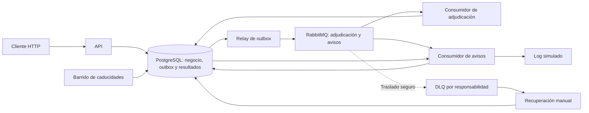

# Citación diagnóstica: documento de traspaso al diseño técnico

Versión: 2026-11-16, revisión 5 · Estado: decisiones hasta Q26 aceptadas. Q25 fija la respuesta a una confirmación repetida tras cancelar; Q26 distingue estado persistido y evaluación temporal en consultas propias. Se conserva Q24 y se corrige su trazabilidad en los criterios anteriores. **No hay implementación ni pruebas de comportamiento ejecutadas acreditadas por este documento.**

Este documento es autónomo: incluye problema, alcance, reglas, contratos acordados, decisiones y alternativas, garantías y límites, escenarios de aceptación y trabajo que corresponde al diseño técnico. No requiere consultar la conversación, el diario ni otras notas de trabajo. El enunciado anonimizado puede acompañarlo como fuente original, pero los comportamientos elegidos están recogidos aquí.

El enunciado exige gestionar disponibilidad, bloqueo temporal, confirmación/cancelación, exclusividad bajo concurrencia y lista de espera con comunicación asíncrona desde liberación hasta aviso. Permite resolver ambigüedades con decisiones razonadas. Las políticas concretas de este documento son decisiones del ejercicio; no se presentan como reglas clínicas ni estándares del sector.

## Índice

- [1. Problema, objetivo y entregable](#1-problema-objetivo-y-entregable)
- [2. Alcance y exclusiones](#2-alcance-y-exclusiones)
- [3. Lenguaje y modelo funcional](#3-lenguaje-y-modelo-funcional)
- [4. Agenda precargada e invariantes](#4-agenda-precargada-e-invariantes)
- [5. Tiempo, plazos y disponibilidad](#5-tiempo-plazos-y-disponibilidad)
- [6. Lista, elegibilidad, orden y prioridad](#6-lista-elegibilidad-orden-y-prioridad)
- [7. Operaciones y fronteras temporales](#7-operaciones-y-fronteras-temporales)
- [8. Coordinación, transacciones y límites del dominio](#8-coordinación-transacciones-y-límites-del-dominio)
- [9. Contrato HTTP e identidad — Q18](#9-contrato-http-e-identidad--q18)
- [10. Idempotencia HTTP](#10-idempotencia-http)
- [11. Outbox, eventos y publicación](#11-outbox-eventos-y-publicación)
- [12. Consumidores, intentos y avisos](#12-consumidores-intentos-y-avisos)
- [13. Reintentos, RabbitMQ, DLQ y retención](#13-reintentos-rabbitmq-dlq-y-retención)
- [14. Stack confirmado y alternativas](#14-stack-confirmado-y-alternativas)
- [15. Aceptación y estrategia de pruebas incorporada](#15-aceptación-y-estrategia-de-pruebas-incorporada)
- [16. Pacientes reales y red de hospitales](#16-pacientes-reales-y-red-de-hospitales)
- [17. Trabajo que corresponde al diseñador técnico](#17-trabajo-que-corresponde-al-diseñador-técnico)
- [18. Trazabilidad de todas las preguntas de cierre](#18-trazabilidad-de-todas-las-preguntas-de-cierre)

## 1. Problema, objetivo y entregable

Un hospital tiene capacidad limitada para realizar pruebas diagnósticas. Distintos pacientes pueden intentar reservar el mismo hueco; otras operaciones pueden confirmarlo, cancelarlo o detectar su caducidad mientras los workers adjudican capacidad a la lista de espera.

El núcleo del problema es **decidir y persistir de forma atómica quién ocupa cada hueco, respetando plazo y prioridad, aunque intervengan procesos distintos**. No se resuelve manteniendo una conexión abierta durante diez minutos, aumentando el pool ni confiando en el orden de llegada de mensajes. PostgreSQL coordina las decisiones de negocio; RabbitMQ comunica trabajo ya comprometido.

La solución debe demostrar:

1. Consulta de agenda y disponibilidad para reserva directa.
2. Bloqueo temporal de un hueco, con caducidad si no se confirma.
3. Confirmación de ese bloqueo o aceptación de una oferta y cancelación de reservas admitidas.
4. Como máximo una asignación ocupante por hueco, incluso con muchas peticiones simultáneas.
5. Lista de espera y oferta exclusiva al primero elegible al liberarse capacidad por cancelación o caducidad de bloqueo, con plazo limitado y paso al siguiente cuando corresponda.
6. Mensajería asíncrona real entre liberación, adjudicación y aviso. El canal hacia el paciente se simula mediante log estructurado; el broker y el procesamiento no se simulan en los recorridos de integración.

Entregable futuro: repositorio ejecutable con un solo comando y README que explique: **a)** decisiones y alternativas, **b)** exclusiones y motivos, **c)** entrega, pérdida, duplicados y desorden, **d)** tratamiento de pacientes reales, **e)** evolución a una red hospitalaria. Habrá datos exclusivamente sintéticos. El tiempo orientativo del enunciado es de seis a ocho horas y la conversación posterior de defensa, unos cuarenta y cinco minutos; son contexto de alcance, no un presupuesto de rendimiento.

La implementación se realizará en un repositorio separado de las notas de trabajo. Repositorio, ejemplos, documentación publicable y artículo usarán un contexto genérico, sin organización, contactos, rutas personales, PDF original ni datos reales. La anonimización de identificadores directos no garantiza que la redacción del enunciado resulte irreconocible.

La separación de responsabilidades acordada es la siguiente; los componentes del worker comparten proyecto y el relay se activa en una única instancia configurada:



## 2. Alcance y exclusiones

### 2.1 Dentro de la demo

- API HTTP y worker como puntos de entrada del mismo proyecto; núcleo compartido de dominio y aplicación.
- PostgreSQL y RabbitMQ reales en Docker Compose, con almacenamiento persistente para reinicios normales.
- Agenda precargada, validación del seed, pacientes sintéticos y simulación explícita de identidad.
- Reservas, lista de espera, exclusiones por rechazo, caducidades, outbox, adjudicación, aviso simulado, reintentos y recuperación manual de DLQ.
- Pruebas unitarias, integración con servicios reales y pocos recorridos E2E por HTTP.
- Esquema SQL inicial y seed versionados, arranque reproducible y explicación de límites.

### 2.2 Fuera y por qué

| Exclusión | Motivo y condición para reconsiderarla |
| --- | --- |
| Crear/modificar agendas durante la ejecución | El foco es asignar capacidad existente; se comprueba previamente su validez. Añadir si administrar capacidad es requisito. |
| Interfaz gráfica | HTTP y pruebas permiten demostrar el problema; añadir por necesidad de usuarios, no para validar la exclusividad. |
| Autenticación real, login, gestión de usuarios y roles sanitarios | Se acepta identidad sintética para demostrar titularidad; integrar identidad verificada antes de permitir uso real. |
| SMS/correo real, confirmación de lectura y garantía externa exactamente una vez | El enunciado permite simulación. Un proveedor real necesita contrato de entrega, protección de datos e idempotencia propios. |
| Integraciones clínicas, asistencia, realización, resultados y correcciones retrospectivas | No son necesarias para citación y concurrencia; una cita sigue confirmada tras empezar sin inferir asistencia. |
| Preferencias horarias, preparación, desplazamiento y prioridades clínicas | Disponibilidad amplia por ámbito y FIFO; validar esas políticas antes de pacientes reales. |
| Varias solicitudes clínicas independientes del mismo paciente en un ámbito | Una inscripción activa por paciente y ámbito permite acotar el modelo; ampliar si existen necesidades clínicas distintas. |
| Optimización global de combinaciones paciente–hueco | Se acepta orden cronológico y FIFO por hueco, aunque no maximice ocupación. |
| Migraciones de bases pobladas | El entorno sintético puede recrearse explícitamente; producción requerirá migraciones controladas. |
| Cursores y continuaciones para adjudicar por lotes | Q13 elige pasada completa para el seed acotado; introducirlos si mediciones justifican su coste. |
| Liderazgo automático del relay y despliegue de alta disponibilidad | Un publicador configurado basta para la demo; su caída conserva trabajo pero demora publicación. |
| k6 y cifras de capacidad/SLO | Carga aplazada hasta tener corrección y una carga representativa definida; no es dependencia obligatoria. |
| Despliegue de producción, particionado, microservicios o multirregión | Se describirá evolución proporcionada a requisitos medidos; no se construye esa infraestructura ahora. |

## 3. Lenguaje y modelo funcional

| Concepto | Significado |
| --- | --- |
| Hospital | Contexto de agenda y pertenencia de recursos; puede tener varios tipos de prueba y ámbitos. |
| Tipo de prueba | Servicio diagnóstico; agrupa recursos equivalentes dentro del hospital. |
| Recurso | Máquina o capacidad concreta que realiza la prueba. |
| Hueco | Intervalo de agenda de un recurso, con identidad estable, hospital, tipo de prueba e inicio/fin. Existe independientemente de quién lo reserve. |
| Reserva | Asignación concreta de un hueco a un paciente. Una asignación posterior tiene otro ID. |
| Bloqueo directo | Reserva temporal solicitada por un paciente, pendiente de confirmar. No es un bloqueo SQL de varios minutos. |
| Oferta | Reserva temporal exclusiva creada para una inscripción elegible de la lista. Existe antes de emitir el aviso. |
| Cita confirmada | La misma reserva tras confirmarse; no se crea una segunda entidad de cita para copiarla. |
| Inscripción | Participación concreta de un paciente en un ámbito, con orden de admisión, situación, historial y exclusiones propios. |
| Ámbito | Hospital más tipo de prueba. Comparte lista, orden de admisión y coordinación de escrituras. |
| Liberación | Fin de la ocupación por una reserva; no implica permiso inmediato de reserva directa si hay espera elegible. |
| Aviso | Comunicación de una oferta existente, con su ID y vencimiento guardados. No crea la oferta ni inicia su plazo. |
| Relay o publicador de outbox | Proceso que transporta publicaciones persistidas en PostgreSQL a RabbitMQ. No es el consumidor que escribe el aviso. |
| Evento/trabajo, intento y publicación | Identidades diferentes: hecho o trabajo lógico estable; ejecución lógica dentro de un ciclo; envío concreto persistido en outbox. |

### 3.1 Estados de reserva

| Estado | Ocupación persistida y salidas |
| --- | --- |
| `HELD` | Bloqueo directo ocupante. Puede pasar a `CONFIRMED` dentro de plazo, a `CANCELLED` por cancelación válida o a `EXPIRED`. |
| `OFFERED` | Oferta exclusiva ocupante. Puede pasar a `CONFIRMED` por aceptación válida, a `CANCELLED` por rechazo/retirada válidos o a `EXPIRED`. |
| `CONFIRMED` | Cita ocupante. Solo cancelación nueva antes del inicio. No caduca por el plazo temporal anterior. |
| `CANCELLED` | Terminal, no ocupante; conserva causa de cancelación, rechazo o retirada según el caso. |
| `EXPIRED` | Terminal, no ocupante; conserva cierre por vencimiento. |

Confirmar o aceptar mantiene la identidad: `HELD → CONFIRMED` u `OFFERED → CONFIRMED`. Una nueva adjudicación del hueco crea otra reserva. Ningún mensaje ni petición sobre R1 modifica R2 por compartir paciente o hueco.

### 3.2 Situaciones de inscripción

El comportamiento distingue espera activa, oferta pendiente y cierre por aceptación, caducidad o retirada. Los nombres físicos de esos estados o de los campos de causa se definirán técnicamente.

Activa incluye esperar y tener oferta pendiente. Aceptar cierra por atención; caducar una oferta cierra por caducidad; retirarse cierra por retirada cuando aún procede. Un rechazo válido devuelve a espera conservando posición y excluye el hueco rechazado. Las causas terminales se conservan y no se sobrescriben por peticiones posteriores.

Una reincorporación voluntaria admitida conforme a Q2 crea una inscripción nueva al final. No se reactiva la anterior. No se impone una restricción global de una sola cita por paciente.

## 4. Agenda precargada e invariantes

### 4.1 Precondición del seed — Q1 y Q13

Agenda inmutable durante la demo, con **hasta veinte huecos futuros por ámbito**. Es un límite del dataset de demostración, no una regla clínica que deba incorporarse a los endpoints ni una capacidad máxima acreditada del sistema.

Validar automáticamente antes de utilizar el seed:

- Intervalos no vacíos, sobre los valores temporales canónicos.
- Sin solapamientos de intervalos de un mismo recurso, aunque los huecos tengan IDs distintos.
- Intervalos contiguos permitidos; coincidencias horarias entre recursos distintos permitidas.
- Relaciones de hospital, tipo, recurso y paciente sintético coherentes.

El mecanismo exacto de validación es técnico. La garantía de exclusividad por ID se defiende **bajo esa agenda válida e inmutable**; no evita por sí misma dobles ocupaciones de intervalos arbitrarios de una máquina.

### 4.2 Invariantes persistidas — Q14

1. Como máximo una reserva en `HELD`, `OFFERED` o `CONFIRMED` por hueco.
2. Como máximo una inscripción activa por paciente y ámbito.
3. Como máximo una reserva `OFFERED` por inscripción.
4. Pareja inscripción–hueco única para exclusiones.
5. Orden de admisión creciente e inmutable por ámbito para cada inscripción nueva.
6. Solo crear asignaciones temporales para huecos futuros en el instante protegido de decisión.
7. Confirmación y aceptación requieren titularidad, estado adecuado y plazo vigente.
8. Lista elegible tiene prioridad sobre reserva directa, incluso durante el intervalo de mensajería.
9. Negocio y trabajo durable asociado se comprometen juntos; rollback no deja estados o publicaciones parciales.
10. Estados terminales no se reactivan; repeticiones no generan nuevos efectos lógicos.
11. Una inscripción nueva no se admite mientras el paciente mantenga algún bloqueo directo `HELD` vigente en su ámbito. Es una condición de esa transición de alta de Q24, no una prohibición global de coexistencia ni una unicidad adicional de bloqueos por paciente.

El contador FIFO se asigna bajo coordinación del ámbito y distingue admisiones en el mismo milisegundo. No se exige numeración sin saltos. Repetir un alta activa o rechazar válidamente conserva el orden; reinscribirse tras cierre obtiene uno nuevo.

Las restricciones se basan en **estados persistidos**, no en expresiones que cambien por el reloj. Una fila temporal vencida sigue ocupante para esas restricciones hasta materializar su cierre. El esquema e índices deben implementar las unicidades, además del protocolo transaccional. PostgreSQL permite [unicidad sobre subconjuntos mediante índices parciales](https://www.postgresql.org/docs/18/indexes-partial.html).

## 5. Tiempo, plazos y disponibilidad

### 5.1 Autoridad y precisión — Q10

- Tiempo de negocio autoritativo obtenido de PostgreSQL tras adquirir la coordinación y leer el estado protegido; no del clic, cliente o inicio de una transacción que pudo esperar bloqueos.
- Dominio, persistencia y HTTP comparten precisión de milisegundos.
- Representar instantes inequívocos con semántica de zona horaria; no interpretar horas locales sin zona como autoridad. El tipo persistido y su adaptación deben preservar esa semántica.
- Truncar reloj y valores internos a milisegundos antes de comparar o persistir; no redondear al siguiente instante.
- Respuestas HTTP ISO 8601 en UTC con tres decimales, por ejemplo `2030-05-10T12:00:00.000Z`.
- Fechas externas con zona u offset explícito y como máximo tres decimales; normalizar a UTC. Rechazar precisión adicional, sin perderla silenciosamente.
- El cliente no fija el instante de decisión ni el vencimiento de una reserva.

`11:59:59.999900` interno se trunca a `11:59:59.999`; una entrada externa con seis decimales queda fuera del contrato. La unidad mínima de pruebas de frontera es **1 ms**. Las fechas no sustituyen el contador FIFO.

El diseño técnico debe evitar usar inadvertidamente tiempo de inicio de transacción para una decisión posterior a una espera. [Funciones de tiempo de PostgreSQL](https://www.postgresql.org/docs/18/functions-datetime.html#FUNCTIONS-DATETIME-CURRENT).

### 5.2 Vencimientos desde creación, limitados por inicio

```text
expires_at_bloqueo = min(created_at + 10 minutos, starts_at_hueco)
expires_at_oferta  = min(created_at + máximo_oferta, starts_at_hueco)
máximo_oferta por defecto = 2 horas, configurable
```

El vencimiento se fija al crear la reserva. Avisos, reintentos, reinicios y respuestas HTTP recuperadas no lo amplían. Los plazos son elecciones para la demo, no estándares hospitalarios. Las pruebas pueden reducirlos mediante configuración.

| Creación a las 10:00 | Resultado |
| --- | --- |
| Oferta para hueco a las 13:00 | Vence a las 12:00. |
| Oferta para hueco a las 11:30 | Vence a las 11:30; la proximidad no elimina prioridad de lista. |
| Bloqueo para hueco a las 11:00 | Vence a las 10:10. |
| Bloqueo para hueco a las 10:05 | Vence a las 10:05. |
| Creación al alcanzar el inicio o después | No crear bloqueo u oferta sin ventana positiva. |

Una liberación a las 10:00 para hueco a las 11:30, cuya oferta se crea a las 10:20, deja setenta minutos de plazo. No contar desde la liberación ni desde el aviso. Cada oferta sucesiva calcula su vencimiento desde su propia creación, siempre limitada por el mismo inicio.

Para reservas temporales pendientes, `t < expires_at` es vigente; **igualdad y después significan vencimiento**, aunque la fila aún muestre `HELD` u `OFFERED`. No hay gracia implícita. Una reserva ya confirmada no caduca por su vencimiento temporal anterior.

### 5.3 Disponibilidad consultada — Q9

Devolver los huecos futuros del intervalo consultado con indicador de si permiten reserva directa, sin exponer pacientes, reservas ajenas ni inscripciones ajenas.

| Fotografía consultada | Reserva directa |
| --- | --- |
| Sin ocupación y sin inscripción elegible para ese hueco | Permitida según esa fotografía. |
| Sin ocupación pero con espera elegible | No permitida; prioridad de lista. |
| Ocupado por bloqueo, oferta o cita | No permitida. |
| Temporal vencida aún sin cierre persistido | Conservadoramente no permitida hasta tramitar el cierre. |
| Inicio alcanzado | Fuera del conjunto de huecos futuros. |

La consulta no caduca filas, adjudica ni modifica datos. Tras el barrido, se reevalúan ocupación y prioridad; no necesariamente pasa a reservable. Es una fotografía: el POST vuelve a decidir y puede encontrar conflicto. El contrato técnico fijará filtros y fronteras del intervalo consultado y una lectura coherente; los nombres exactos de los campos no están impuestos.

## 6. Lista, elegibilidad, orden y prioridad

### 6.1 Ámbito y elegibilidad

Una lista por hospital y tipo de prueba, compartida por recursos equivalentes. Disponibilidad amplia en ese ámbito; no hay preferencias de fecha o franja.

Una inscripción es elegible para un hueco cuando pertenece al ámbito, está esperando, no tiene otra oferta activa y no excluyó ese hueco por rechazo. El hueco debe ser futuro y no tener reserva ocupante tras las transiciones que procedan. Las entradas cerradas no participan. No se exigen dos horas completas de antelación.

No tener oferta para un hueco porque no se llegó a crear antes del inicio **no cierra** la inscripción. Caducar una oferta existente sí la cierra. Caducar el bloqueo directo de Carlos no cierra la participación de Ana o Bruno.

### 6.2 Unicidad, altas y reincorporación — Q2

**Q2 revisada:** no crear una participación nueva si existe algún hueco del ámbito reservable directamente en el estado protegido. Informar de esa disponibilidad con `409` y un motivo de negocio identificable, incluyendo referencias públicas suficientes para continuar por reserva directa. No crear inscripción, prioridad de lista ni resultado exitoso de alta para esa clave. El paciente debe solicitar el bloqueo con su propia clave; puede perder la carrera hasta hacerlo. Esa respuesta no reserva el hueco.

La decisión se toma en este orden, dentro del protocolo transaccional común:

1. Coordinar el registro de la clave y releer su resultado tras obtener esa coordinación, incluso si una lectura previa no lo encontró. Si ya tiene resultado exitoso y su huella coincide, devolverlo sin reinterpretar la intención ni modificarlo según el estado actual. Una huella incompatible se rechaza.
2. Para una clave nueva sin resultado exitoso, adquirir el ámbito y reconsultar la participación y los bloqueos propios del paciente. Obtener el tiempo autoritativo después de esperar esa coordinación: una petición iniciada antes del vencimiento puede decidirse después. Si su oferta pendiente venció, materializar `EXPIRED`, cierre por caducidad y liberación/outbox, incluso si el barrido aún muestra `OFFERED`. Materializar asimismo la caducidad y liberación de sus bloqueos propios vencidos en el ámbito, aunque el hueco ya haya empezado. No devolver una inscripción vencida como activa ni vincularle la clave nueva.
3. Si sigue existiendo una inscripción realmente activa, devolverla con `200`, conservando identidad, orden, exclusiones y plazo; registrar ese resultado para la nueva clave. Esta repetición de participación no crea una admisión.
4. Si no hay inscripción activa, materializar los demás vencimientos pertinentes de los huecos futuros antes de decidir admisión. Así una fila `HELD`/`OFFERED` vencida no altera Q2/Q24 por retraso del barrido. Respetar el orden de bloqueos y los cierres de inscripciones asociados. GET conserva su política de lectura sin efectos de 5.3.
5. **Q24, solo ante una admisión nueva:** si el paciente mantiene algún bloqueo directo `HELD` con `t < expires_at` en ese hospital y tipo de prueba, responder `409` con motivo `ACTIVE_HOLD_IN_SCOPE`. Conservar el bloqueo y su vencimiento; no crear inscripción ni registrar éxito de alta para esa clave. Un bloqueo de otro ámbito no activa esta condición. Las caducidades ya materializadas y sus liberaciones se comprometen pese al conflicto; el rechazo de admisión no genera trabajo por alta.
6. Si no hay bloqueo propio vigente que impida la admisión y queda algún hueco reservable directamente, aplicar Q2: informar disponibilidad con `409`, sin inscripción ni éxito de alta. Ese motivo es distinguible de `ACTIVE_HOLD_IN_SCOPE`. Los cierres y liberaciones decididos se comprometen pese al conflicto.
7. Si no hay bloqueo propio vigente ni disponibilidad directa, crear la nueva inscripción al final y guardar **revisión durable del ámbito y resultado exitoso de su clave en la misma transacción**. La respuesta `201` acredita admisión, no oferta inmediata. Huecos libres protegidos por espera elegible no cuentan como reservables directamente. Una liberación de esa misma transacción que ya activa la revisión del ámbito puede cubrirla; no duplicar la solicitud por haber registrado también la nueva admisión.

La nueva admisión, incluida la reincorporación I2 cuando procede, no puede comprometerse separada de su trabajo. Un fallo técnico que revierte la transacción no deja cierre, liberación, I2 o resultado exitoso parciales. El resultado `409` de disponibilidad no se cachea como éxito: si se reintenta sin ese éxito registrado, se vuelve a evaluar el estado, conforme al contrato de creaciones.

Con el resto de estado estable, dos peticiones HTTP concurrentes con K2 crean como máximo una I2 y una liberación lógica de la oferta vencida. Si una crea I2 y guarda éxito, la otra recupera ese mismo resultado; si corresponde informar capacidad directa, ambas pueden responder `409` sin asociar K2 a I1 ni a una inscripción inexistente. Si después cambia realmente la disponibilidad, un nuevo intento sin éxito previo puede obtener otra decisión: conservar errores como si fueran altas exitosas no forma parte del contrato.

**Ejemplo combinado con reinscripción:** I1 de Ana tiene oferta que vence a las 12:00; a las 12:01 llega K2 nueva. Cerrar I1 y su oferta antes de decidir. Si no hay bloqueo propio vigente ni hueco reservable directamente —por ejemplo H1 está protegido por Bruno, que ya esperaba—, crear I2 al final y vincular K2 a I2. Si queda un bloqueo propio vigente del ámbito, aplicar Q24; si no y H1 queda directamente reservable, informar disponibilidad. Ambos conflictos dejan a Ana sin I2 ni éxito de alta para K2. Con resto de estado y tiempo equivalentes, la decisión no depende de que el barrido esté detenido o ya haya actuado. Repetir K1 conserva el resultado histórico de I1. Una K2 que ya obtuvo éxito legítimo antes del vencimiento también lo conserva: no vuelve a ser una intención nueva.

**Carrera alta/liberación:** si la liberación se consumió sin candidatos y el hueco sigue reservable directamente, el alta informa disponibilidad y no deja a nadie esperando sin activador. Si el alta se decide mientras no hay disponibilidad directa, su admisión guarda revisión propia; una liberación posterior activa además el flujo común. Se respeta el orden transaccional real, sin prometer el mismo resultado para órdenes distintos de cambios de negocio ni prioridad por clic.

La Q2 revisada sustituye la admisión aun con capacidad directa libre, aceptando segunda petición y carrera. Q24 añade la protección del recorrido que fabricaba ocupación con un bloqueo propio vigente antes del alta. Admitir siempre seguiría siendo otra política defendible, pero requeriría aceptar expresamente esa diferencia de prioridad/plazo; queda descartada para este ejercicio.

### 6.3 Selección común — Q3 y Q7

En **cada decisión protegida** de adjudicación del ámbito:

1. Considerar los huecos libres y futuros con alguna inscripción elegible.
2. Elegir el de inicio más temprano; desempatar por ID estable del hueco.
3. Para ese hueco, elegir la inscripción elegible de menor orden de admisión persistido.
4. Crear oferta, actualizar participación y registrar aviso durable atómicamente.
5. Continuar mientras exista otra combinación adjudicable dentro de la revisión completa.

Liberaciones, nuevas admisiones y retornos a espera usan la misma revisión del ámbito. El hueco referenciado por un evento explica la causa, no limita la búsqueda. Un mensaje de H2 no permite adelantarlo a H1 anterior adjudicable. Una liberación antigua no libera una reserva actual: puede activar revisión sobre otras combinaciones vigentes.

En particular, el consumidor no abandona la revisión porque el hueco de origen esté excluido para una inscripción, ocupado nuevamente o ya iniciado. Esas condiciones pueden impedir adjudicar ese hueco, pero no descubrir H2 u otros futuros del ámbito. Comprobar ocupación del hueco original y terminar sin revisar el ámbito incumpliría Q3/Q7.

Se consideran estados comprometidos visibles a la decisión; no se anticipan liberaciones futuras ni se revocan ofertas válidas ya comprometidas para mejorar un reparto posterior.

**Coste aceptado del criterio:** Ana precede a Bruno; Ana admite H1/H2; Bruno excluyó H2; H1 empieza antes. Resultado: Ana recibe H1 y Bruno espera, aunque H2 quede libre. No se busca un emparejamiento global que otorgue Ana–H2 y Bruno–H1.

### 6.4 Prioridad frente a reserva directa

Prioridad calculada a partir de reservas e inscripciones vigentes, **sin marcador permanente de adjudicación pendiente en el hueco**. No basta «no hay reserva ocupante»: si alguien es elegible para H, la reserva directa no puede adelantársele mientras espera el consumidor.

Una inscripción con otra oferta o que excluyó H no impide por sí sola la reserva directa de H si no hay otro elegible. Cuando una transición recupera elegibilidad, debe dejar activación durable para que el sistema progrese sin depender del cliente.

### 6.5 Corrección H1/H2 y revisión sin cursores — Q13

Ana es la única inscripción y tiene oferta vigente de H1. Se libera H2; su evento se consume sin oferta porque Ana sigue ocupada con H1. Después rechaza válidamente H1.

En la transacción del rechazo: cancelar oferta de H1 con causa de rechazo, devolver inscripción a espera conservando orden, excluir H1 y guardar **un único `SlotReleased` de H1**, con su causa trazable. Por Q3/Q7, ese evento ya activa revisión del ámbito completo: encuentra H2 y crea una sola oferta para Ana. No emitir además `AllocationReviewRequested` por ese mismo rechazo; se elimina una segunda pasada redundante sin perder trabajo durable. La solicitud explícita sigue disponible para altas admitidas que no liberan hueco. No requiere otra cancelación, petición externa o reentrega accidental del evento antiguo de H2, ni otorga prioridad especial al causante.

La demo realiza **una revisión completa en una transacción** para el seed de hasta veinte huecos futuros por ámbito. Materializa vencimientos pertinentes y continúa después de huecos excluidos o sin candidatos, respetando siempre el criterio común. Sin cursores ni mensajes de continuación de adjudicación.

Motivo de evitar cursores: añadirían estado de progreso, recuperación y reglas para no omitir huecos anteriores al cursor que vuelven a ser adjudicables. Con el volumen elegido no se justifica ese coste sin mediciones. La duración depende también de lista, exclusiones, historial, índices y consultas; medir transacción y espera del bloqueo.

El requisito antiguo de progreso durable por lotes pasa a ser **condición de evolución**, no implementación de esta demo. Si se introducen lotes, deberán avanzar aunque no adjudiquen nada, sobrevivir a fallos y conservar la prioridad global ante cambios; no basta avanzar por el último adjudicado o ignorar nuevos candidatos detrás de un cursor. El barrido de vencimientos puede seguir buscando candidatos en lotes: es una responsabilidad diferente.

### 6.6 Q24: bloqueo propio vigente y admisión nueva

**Decisión aceptada:** aplicar `ACTIVE_HOLD_IN_SCOPE` únicamente cuando se va a crear una inscripción nueva y existe un `HELD` propio vigente del mismo hospital y tipo de prueba. La comprobación usa la coordinación ya elegida y el tiempo autoritativo obtenido después de esperar; no depende solo del estado persistido.

Orden: recuperar éxito previo de la clave → resolver vencimientos → devolver una inscripción realmente activa si existe → comprobar Q24 para nueva admisión → aplicar disponibilidad de Q2 → admitir si procede. Un éxito histórico se devuelve con su código original; una activa existente con clave nueva devuelve `200` y registra ese éxito. Q24 no reevalúa ni invalida esos dos resultados.

**Caso que se cierra:** Ana bloquea el último hueco, solicita alta nueva y recibe `409 ACTIVE_HOLD_IN_SCOPE`; conserva el vencimiento del bloqueo y no obtiene inscripción ni éxito de alta. Cancela el bloqueo: su `SlotReleased` revisa el ámbito, pero Ana continúa sin inscripción ni oferta. Una petición de alta rechazada no deja prioridad latente para activarla al cancelar.

**Bloqueo que vence durante la espera:** en `t >= expires_at` ya no satisface Q24; materializar su caducidad/liberación y aplicar Q2. Si queda capacidad directa, `409` informativo sin inscripción ni éxito; si otro paciente tiene prioridad y no hay capacidad directa, `201` con nueva inscripción al final y resultado/activación atómicos. Misma decisión que con el barrido ya ejecutado y estado equivalente. No ampliar el vencimiento ni registrar caducidad y cancelación de la misma reserva.

**Límite deliberado:** no añadir «el paciente nunca puede tener bloqueo e inscripción a la vez» al modelo ni al endpoint de bloqueo. Ana puede tener una oferta de H2 y bloquear H1 directamente si H1 cumple las reglas de ocupación, tiempo y prioridad. Si ya existe I1 realmente activa, una nueva petición de alta la devuelve aunque haya un `HELD` propio. Q24 tampoco impide por sí misma el alta de otro ámbito ni introduce una unicidad de bloqueos por paciente. Una prohibición más amplia requeriría otra política y justificación.

Motivo frente a permitir esta nueva admisión: la secuencia bloqueo propio → alta → cancelación permitía convertir diez minutos en hasta dos horas sin infringir exclusividad ni FIFO. Comprobar existencia bajo el ámbito tiene un coste proporcional al cierre de esa vía. Se descarta ampliar la regla a toda coexistencia, a cualquier ámbito o a otras clases de reserva. Reconsiderar el alcance solo ante un requisito de producto explícito.

En particular, el recorrido bloqueo → confirmación → alta sin disponibilidad directa → cancelación de la cita antes del inicio → oferta del mismo hueco sigue permitido si se cumplen las reglas de admisión y el paciente resulta primero elegible. Al decidir esa alta ya no existe un `HELD` vigente que active Q24. Es una consecuencia del alcance aceptado, no una protección general frente a toda nueva oferta sobre capacidad que el paciente ocupó antes. AC68 documenta este recorrido sin ampliar la prohibición a `CONFIRMED`.

## 7. Operaciones y fronteras temporales

Todas las decisiones siguientes presuponen identidad/titularidad válida y estado reconsultado bajo la coordinación común. Peticiones sobre recursos inexistentes o ajenos siguen el contrato HTTP.

### 7.1 Crear bloqueo y confirmar

Crear bloqueo directo solo si el hueco es futuro, no está ocupado y no existe prioridad de lista elegible para él. Guardar reserva `HELD`, creación y vencimiento, junto con el resultado de idempotencia y el trabajo durable pertinente. No abrir una conexión durante todo su plazo.

Confirmar exige reserva propia `HELD` u `OFFERED` vigente. En `OFFERED`, cerrar además la inscripción por aceptación; mantener la identidad de la reserva al pasar a `CONFIRMED`. Si sigue `CONFIRMED`, repetir la confirmación devuelve `200` con esa reserva y sin efectos nuevos. Si después fue cancelada, prevalece el estado actual y la repetición devuelve `409` según Q25; no recuperar la confirmación histórica como si todavía estuviera vigente. No confirmar reservas canceladas/caducadas ni sustituir el ID por el de una asignación posterior.

Una confirmación temporal tardía responde `409` y no puede tener éxito con el barrido detenido. Antes de reutilizar ocupación debe materializarse el cierre y sus efectos correctos. Si la petición materializa esa caducidad, conserva cierre y outbox pese al `409`; no permitir que la representación HTTP deshaga un cierre que decidió comprometer. La elección técnica de limpieza en esa operación no concede vigencia extra.

### 7.2 Cancelar — Q4 y Q22

| Situación de la reserva concreta | Resultado |
| --- | --- |
| `HELD` y `t < expires_at` | `CANCELLED`, liberación durable; `200`. |
| `HELD` y `t >= expires_at`, barrido atrasado | `EXPIRED` y liberación/outbox atómicas; `409` por bloqueo vencido. Comprometer el cierre pese al conflicto HTTP. |
| Ya `EXPIRED` | `409` por vencimiento; sin repetir cierre ni liberación. |
| `CONFIRMED` y `t < starts_at` | Cancelación válida, `CANCELLED`, liberación durable; `200`. |
| Cancelación nueva de `CONFIRMED` con `t >= starts_at` | `409`; permanece `CONFIRMED`, sin caducidad ni liberación. |
| Cancelación válida anterior de esa reserva, repetida después | `200`, conserva resultado; sin efectos nuevos ni caducidad retrospectiva. |

El endpoint de cancelación cubre bloqueos directos y citas confirmadas; una oferta se rechaza o se libera mediante retirada, sin convertir `cancel` en una ruta alternativa para el rechazo. Una cita confirmada no caduca por el viejo TTL. Cancelar R1 no toca R2 del mismo hueco. Una liberación consumida tras el inicio no permite ofrecer ese hueco pasado, pero revisa otros futuros del ámbito.

### 7.3 Rechazar oferta y política mixta

| Oferta pendiente | Reserva | Inscripción y trabajo |
| --- | --- | --- |
| Rechazo con `t < expires_at` | `CANCELLED` con causa de rechazo. | Vuelve a espera, conserva orden y excluye el hueco; un `SlotReleased` en el mismo commit activa revisión de todo el ámbito. |
| Rechazo con `t >= expires_at`, aunque aún diga `OFFERED` | `EXPIRED`. | Cierra por caducidad y guarda liberación; `409`. Sin retorno a espera ni activación por recuperación de elegibilidad. |
| Repetición de rechazo válido ya comprometido | Mantiene el resultado anterior. | No caduca retrospectivamente, repite eventos ni altera una oferta o inscripción posterior. |

La caducidad de oferta sin aceptación cierra la inscripción; una reinscripción admitida según Q2 crea otra al final. El rechazo válido de un hueco distingue «esta fecha no» de «ya no quiero la prueba». El cierre por caducidad no demuestra que el paciente recibió el aviso ni que perdió interés.

### 7.4 Retirarse — Q23

Retirada significa «cerrar **esta participación** si sigue activa». Siempre referida al ID solicitado, nunca «buscar la inscripción activa actual del paciente».

| Estado bajo coordinación | Resultado |
| --- | --- |
| Espera activa sin oferta | Cerrar por retirada; `200`. |
| Oferta activa con `t < expires_at` | Cancelar oferta, cerrar por retirada y guardar liberación/outbox atómicamente; `200`. |
| Oferta pendiente con `t >= expires_at`, aunque el barrido no actuó | Caducar oferta y cerrar por caducidad, conservar su causa y liberación/outbox; `200`. |
| Ya cerrada por aceptación, caducidad o retirada | `200` con estado y causa reales; sin cambios ni efectos nuevos. |

Si aceptación válida gana, confirma y cierra la participación; retirada posterior conserva la cita. Si retirada válida gana, cancela oferta y cierra; aceptación posterior encuentra conflicto. En el vencimiento ya no cabe aceptación válida. Retirar I1 no afecta a una reinscripción I2 posterior.

### 7.5 Vencimientos automáticos

Barrido periódico en el worker sobre PostgreSQL; intervalos y búsqueda de candidatos configurables. Para cada candidato, adquirir coordinación en orden común y revalidar estado/tiempo antes de cambiarlo. No bloquear candidatos primero si eso invierte el orden de dominio.

`HELD` vencido: `EXPIRED` y liberación. `OFFERED` vencida: `EXPIRED`, cierre de su inscripción y liberación. `CONFIRMED`, canceladas o ya caducadas no se vuelven a procesar. Al alcanzar el inicio no se ofrecen huecos pasados; una inscripción sin oferta sigue en espera.

El barrido recupera atrasos tras reinicio desde fechas persistidas. Su retraso no concede vigencia extra ni cambia las causas de rechazo, cancelación o retirada. No se usa TTL del broker ni temporizador en memoria como autoridad de caducidad.

### 7.6 Confirmación repetida tras una cancelación — Q25

Secuencia: confirmar R1 correctamente → cancelar R1 correctamente → recibir una repetición atrasada de la confirmación de R1. R1 permanece `CANCELLED`; responder `409` con un motivo distinguible de estado incompatible, el identificador R1 y su estado actual `CANCELLED`. No modificarla, liberar otra vez el hueco, producir eventos nuevos ni afectar a una reserva R2 posterior.

Si R1 sigue `CONFIRMED`, la repetición devuelve `200` con esa reserva y su estado actual, sin nuevos efectos. Su antiguo plazo temporal no vuelve a caducarla. Esta idempotencia de efectos no equivale a recuperar cualquier éxito histórico después de una transición posterior.

La recuperación inmutable del resultado exitoso y código originales mediante `Idempotency-Key` sigue aplicándose a las creaciones del apartado 10; no se extiende implícitamente a las transiciones sin clave. La estructura JSON concreta queda para el diseño técnico, conservando los datos y semánticas anteriores. AC65 cubre ambos resultados.

## 8. Coordinación, transacciones y límites del dominio

### 8.1 Protocolo común — Q8 y Q15

Existe una fila estable por hospital/tipo de prueba, incluso con lista vacía. **Todas** las modificaciones de reservas e inscripciones coordinan por ella: altas, bloqueos, confirmaciones, cancelaciones, rechazos, retiradas, caducidades y adjudicaciones.

Orden de responsabilidades:

1. Si la operación lo requiere, coordinar técnicamente su registro de idempotencia HTTP o su evento/consumidor/intento.
2. Adquirir el ámbito como primer bloqueo de negocio.
3. Bloquear hueco y filas de reserva/inscripción necesarias en orden consistente; consultar estado vigente después de conseguir la coordinación.
4. Obtener tiempo autoritativo y decidir reglas con ese estado protegido.
5. Guardar negocio, resultados/deduplicación y outbox relacionados en una transacción breve, con el mismo cliente `pg`.
6. Comprometer antes de comunicar éxito o reconocer consumo; publicar y avisar fuera de los bloqueos de dominio.

El diseño técnico fijará un orden total consistente también entre coordinaciones técnicas. No adquirirlas en orden inverso desde caminos que ya mantienen el ámbito. En la recuperación tras rollback se vuelve a coordinar y comprobar lo que otras entregas hayan completado.

El aislamiento y las consultas deben ofrecer lecturas vigentes tras esperar; un bloqueo no refresca por sí solo cualquier snapshot anterior. `READ COMMITTED` con lecturas posteriores es una base posible; debe justificarse el protocolo concreto. [Aislamiento de PostgreSQL](https://www.postgresql.org/docs/18/transaction-iso.html#XACT-READ-COMMITTED).

La fila padre no bloquea automáticamente todas sus relaciones. Todos los escritores deben respetar el protocolo; unicidad es defensa adicional. Bloquear una reserva inexistente no protege un hueco libre: la fila estable de ámbito/hueco existe antes de asignarlo. [Bloqueos de fila](https://www.postgresql.org/docs/18/explicit-locking.html#LOCKING-ROWS).

### 8.2 Coste y límites

Se acepta serializar brevemente operaciones de huecos distintos del mismo ámbito. Ámbitos distintos pueden progresar independientemente. No mantener conexiones ni bloqueos durante diez minutos/dos horas, mientras espera el paciente, al publicar al broker o al escribir el aviso.

GET de disponibilidad y relay no necesitan por sí mismos el bloqueo de escritura del ámbito. Un pool es un recurso operativo: limitarlo y sumar conexiones de API, consumidores, barrido y relay; aumentarlo no sustituye la exclusividad y puede empeorar saturación. Acotar espera de bloqueos y clasificar deadlocks/fallos transitorios sin tratarlos como huecos ocupados.

### 8.3 Hexagonal y DDD — Q19

Reglas puras de reserva e inscripción sin HTTP, SQL o AMQP; casos de uso coordinan la operación; adaptadores implementan consultas, bloqueos, transporte y reloj autoritativo.

Puerto transaccional **específico de citación**, con operaciones concretas y atomicidad compartida, sin exponer `PoolClient` ni imponer repositorios CRUD genéricos. El ámbito de coordinación no obliga a cargar toda agenda/lista como un agregado gigante. Las restricciones de BD complementan las reglas; no las sustituyen.

API y worker comparten núcleo y composición explícita de dependencias. No crear un microservicio por responsabilidad ni una interfaz por consulta sin beneficio. La organización de carpetas, firmas y contratos internos queda para el diseñador técnico.

## 9. Contrato HTTP e identidad — Q18

### 9.1 Identidad de demo

`X-Patient-Id` identifica a un paciente sintético existente en un modo de demostración explícito. El adaptador entrega esa identidad a los casos de uso; no confiar en un propietario contradictorio del cuerpo. Comprobar titularidad de cada reserva/inscripción y separar registros de idempotencia por paciente.

La cabecera puede falsificarse: prueba titularidad **bajo la identidad presentada**, no autenticación real ni resistencia a suplantación. Sin autenticación, login ni proveedor de identidad en el ejercicio. Validar cabecera ausente, formato y paciente inexistente con respuestas explícitas que concretará el contrato técnico.

### 9.2 Operaciones aceptadas

| Operación | Ruta | Condición principal |
| --- | --- | --- |
| Agenda/disponibilidad | `GET /slots` | Futuros del intervalo y ámbito, indicador de reserva directa, sin efectos ni datos ajenos. |
| Bloqueo directo | `POST /slots/:id/holds` | `Idempotency-Key` obligatoria; plazo y prioridad comprobados atómicamente. |
| Reserva propia | `GET /reservations/:id` | Titularidad; estado persistido y evaluación temporal diferenciados según Q26, sin efectos. |
| Confirmar bloqueo/aceptar oferta | `POST /reservations/:id/confirm` | Misma reserva, propia y vigente; repetición según estado actual y Q25. |
| Cancelar bloqueo/cita | `POST /reservations/:id/cancel` | Q4/Q22; sin usarla como rechazo de oferta. |
| Rechazar oferta | `POST /reservations/:id/reject` | Política mixta y frontera temporal. |
| Alta/reinscripción | `POST /waiting-list-entries` | `Idempotency-Key` obligatoria; recuperar éxito, resolver vencimientos y activa existente; Q24 y después Q2 antes de nueva admisión. |
| Inscripción propia y oferta | `GET /waiting-list-entries/:id` | ID concreto y titularidad; estado persistido y evaluación temporal de su oferta según Q26, sin datos ajenos ni efectos. |
| Retirada | `POST /waiting-list-entries/:id/withdraw` | Q23; cerrada devuelve causa real y no cancela cita confirmada. |

### 9.3 Respuestas

- `201`: creación de recurso nuevo.
- `200`: consulta, transición válida, repetición válida de transición o inscripción activa devuelta en una operación nueva.
- `400`: entrada inválida.
- `404`: recurso inexistente o ajeno.
- `409`: conflicto de negocio: ocupación, prioridad, estado/plazo incompatible, reutilización incompatible de clave o admisión impedida por Q24/Q2. `ACTIVE_HOLD_IN_SCOPE` identifica bloqueo propio vigente al decidir nueva alta; informar disponibilidad directa usa otro motivo distinguible. Ambos rechazos de admisión no crean participación ni registran éxito de alta; no revierten caducidades/liberaciones ya decididas.
- `503`: indisponibilidad transitoria necesaria para completar la operación; no convertir todos los errores internos en `503`.

Un replay por clave devuelve también el código exitoso original: un `201` original sigue siendo `201`. El estado actual se obtiene mediante GET, no reinterpretando como actual el cuerpo histórico del replay.

Una petición puede comprometer caducidad y responder `409`: separar resultado de negocio/commit de su representación HTTP. Incluye el alta con clave nueva que cierra I1 vencida y después informa disponibilidad directa sin crear I2. Retirada con caducidad usa el `200` específico de Q23. No revertir cierres por convertir después el resultado en respuesta de conflicto.

Si PostgreSQL permite guardar negocio y outbox, la caída de RabbitMQ por sí sola no exige rechazar esa operación HTTP. La publicación queda pendiente; no se afirma que se haya enviado el aviso ni se promete cuándo llegará. Cuerpos, errores identificables, filtros y esquemas exactos se detallarán técnicamente, conservando estas rutas y semánticas.

### 9.4 Consultas propias con caducidad pendiente — Q26

`GET /reservations/:id` y `GET /waiting-list-entries/:id` devolverán de forma claramente diferenciada:

- Estado persistido de la reserva o inscripción y el vencimiento guardado de la reserva temporal cuando corresponda.
- Instante de evaluación obtenido de PostgreSQL, con la precisión de milisegundos y representación UTC acordadas.
- Evaluación temporal que indique si la reserva temporal ya venció y si su cierre persistido sigue pendiente.
- Qué acciones ya no permite: una reserva temporal vencida no se puede confirmar ni aceptar, aunque siga almacenada como `HELD` u `OFFERED`.

Para la inscripción cuya oferta ya venció, la respuesta indicará oferta vencida y cierre pendiente aunque su fila todavía figure activa. No la presentará como participación esperando otra oferta ni como oferta aún aceptable. El estado y la causa persistidos no se reescribirán para simular que el cierre ya se comprometió.

La evaluación de caducidad corresponde solo a reservas temporales pendientes. Una `CONFIRMED` no se mostrará vencida por su antiguo plazo; una inscripción en espera sin oferta no adquiere un vencimiento ficticio.

Estas consultas no modificarán filas ni emitirán eventos. La evaluación es una fotografía coherente del estado observado y el tiempo indicado, no una garantía de que una acción posterior vaya a tener éxito. El POST volverá a validar. GET de disponibilidad conserva su respuesta conservadora de 5.3. Los nombres de campos y esquemas exactos se fijarán técnicamente sin mezclar estado persistido y evaluación derivada. AC66–AC67 cubren antes, igualdad y después del vencimiento con barrido detenido, además de las reservas ya confirmadas.

## 10. Idempotencia HTTP

Para **crear bloqueos e inscripciones/reinscripciones**, el cliente genera una `Idempotency-Key` antes de la primera petición de una intención y la reutiliza con los mismos datos en todos sus reintentos. Nueva intención, nueva clave. Si necesita reintentar tras reiniciar el cliente, debe conservar esa asociación; no generar una clave por intento.

Registro en PostgreSQL con paciente, operación, clave, huella del destino y datos normalizados y resultado exitoso. Clave, resultado, negocio y outbox se comprometen atómicamente. Las peticiones simultáneas con la misma clave deben coordinarse entre instancias, no solo en memoria.

| Caso | Comportamiento |
| --- | --- |
| Misma clave registrada, paciente/operación y datos | Resultado exitoso original sin creación, evento o plazo nuevo. |
| Misma clave en el mismo ámbito de operación con otro destino/datos | Rechazar uso incompatible; no ejecutar otra intención. |
| Clave nueva y existe inscripción realmente activa tras comprobar su oferta/plazo | Devolver la existente, sin cambiar orden, exclusiones o plazo; registrar ese resultado para futuros replays. No considerar activa una I1 con oferta vencida pendiente de barrido. |
| Clave nueva e I1 con oferta vencida | Caducar/cerrar I1 y guardar liberación; después evaluar Q24 y Q2. I2 solo si no hay bloqueo propio vigente del ámbito ni capacidad directa; en otro caso `409` con su motivo, sin éxito de alta. |
| Clave nueva sin inscripción activa y con bloqueo propio vigente del ámbito | `409 ACTIVE_HOLD_IN_SCOPE`; conservar bloqueo/plazo, sin inscripción ni éxito de alta para la clave. |
| Clave nueva sin inscripción activa, bloqueo propio vigente del ámbito ni disponibilidad directa | Nueva admisión al final, revisión durable y resultado exitoso atómicos. |
| Clave nueva sin inscripción activa y con disponibilidad directa | `409` con motivo y referencias de disponibilidad; sin admisión, prioridad ni resultado exitoso asociado a la clave. |
| Claves iguales de pacientes distintos | Registros independientes. |
| Rollback | No queda éxito falso ni creación parcial; permite reintentar. No cachear indiscriminadamente los `500`. |

Ejemplo: K1 crea I1; se pierde respuesta; I1 recibe oferta y vence. Repetir K1 devuelve el resultado ligado a I1, **no crea I2 ni normaliza su estado por ese replay**. Reincorporarse usa K2 nueva: cerrar primero I1 aunque el barrido esté detenido; crear I2 al final solo si no hay otra activa, bloqueo propio vigente del ámbito ni disponibilidad directa. En caso contrario, el `409` usa el motivo de Q24 o Q2 según corresponda, sin vincular K2 a I1 vencida ni a una inscripción ficticia.

Confirmar, cancelar, rechazar y retirar se dirigen a un recurso concreto y no exigen clave. La idempotencia impide repetir efectos; no obliga a devolver un éxito histórico frente a cualquier estado posterior. Q25 devuelve `200` si la reserva sigue confirmada y `409` si después fue cancelada, con identificación y estado actuales. Se conservan las repeticiones válidas específicas de cancelación y rechazo; estados incompatibles no se reviven. Retirar una inscripción cerrada es explícitamente válido y devuelve `200` con su causa real según Q23; no tratarlo como un conflicto genérico.

## 11. Outbox, eventos y publicación

### 11.1 Fronteras atómicas

Negocio e intención durable de comunicación se guardan en PostgreSQL juntos. Casos fundamentales:

| Transición | Trabajo durable asociado |
| --- | --- |
| Cancelación/caducidad que libera ocupación | Activación de revisión del ámbito, con referencias de la liberación. |
| Nueva admisión/reinscripción sin disponibilidad directa | Revisión del ámbito comprometida con inscripción y resultado exitoso; `AllocationReviewRequested` si no existe ya en esa transacción una liberación que cubra esa activación. |
| Alta nueva que detecta oferta/reservas vencidas | Cierres y liberaciones pertinentes; `SlotReleased` activa revisión. Si Q2 informa capacidad directa, no existe evento de nueva admisión ni inscripción ficticia. |
| Rechazo válido que recupera elegibilidad | Un `SlotReleased` del hueco rechazado, con causa; por Q3/Q7 revisa todo el ámbito. Sin segunda solicitud de revisión por ese mismo rechazo. |
| Creación de oferta | Aviso pendiente para esa reserva y vencimiento ya guardados. |
| Fallo lógico recuperable | Resultado del intento y siguiente ejecución programada, tras rollback del negocio fallido. |
| Agotamiento/permanente | Resultado de fallo y publicación pendiente hacia DLQ. |
| Recuperación manual | Registro de recuperación/nuevo ciclo y siguiente trabajo, antes de retirar la entrega de DLQ. |

Una publicación puede ser redundante sin ser incorrecta: los consumidores revalidan y deduplican. No mantener el bloqueo de ámbito mientras llega una confirmación del broker.

### 11.2 Eventos mínimos y estado vigente

Referencias y datos mínimos, sin instantáneas de pacientes ni información clínica/contactos. Ejemplos de nombres conceptuales, cuyo sobre exacto se definirá:

- `SlotReleased`: ámbito, hueco y reserva que terminó; es un hecho, no orden de liberar otra reserva actual.
- `AllocationReviewRequested`: ámbito y causa trazable; activa revisión completa vigente.
- `OfferCreated`: referencia concreta de oferta y datos mínimos para identificar su aviso; no una orden de crear otra oferta.

Versionar y validar contratos. Conservar identidad lógica estable, consumidor, ciclo/intento y referencias necesarias. Timestamps de eventos no ordenan pacientes ni autorizan transiciones. Publicaciones distintas o eventos distintos antiguos requieren estado vigente aunque no sean duplicados exactos.

### 11.3 Publicador único configurado — Q11

Un relay activo por configuración, dentro del worker y compartiendo proyecto. W1 publica y puede consumir; W2 y demás réplicas solo consumen. **Sin elección de líder, advisory lock ni relevo automático en la demo.** Una configuración equivocada no se presenta como imposible; la seguridad sigue tolerando duplicados.

W1 caído: outbox pendiente permanece en PostgreSQL hasta reiniciarlo. No es alta disponibilidad del relay. El liderazgo automático se reconsideraría con ese requisito, junto con detección de pérdida de liderazgo y publicaciones inciertas.

Una publicación pendiente de confirmación a la vez en el relay. Usar confirmaciones y `mandatory`; un `basic.return` por falta de ruta significa publicación fallida aunque llegue confirm positivo. Marcar publicada solo con recepción confirmada y ruta válida. Ante error, timeout o canal/conexión cerrados, conservar publicación pendiente y recuperar conexión/canal/topología según protocolo.

**Progreso ante una ruta rota:** un fallo de una publicación no bloquea indefinidamente las demás. Persistir el error, el contador de envíos y una próxima fecha de intento con espera positiva para esa publicación. Elegir únicamente pendientes cuya fecha haya llegado, con un orden total estable —por ejemplo próxima fecha, creación e ID— y continuar con otras listas para enviar. Conservar evento, intento lógico y trabajo pendiente; el contador de transporte no consume los cuatro intentos del consumidor ni autoriza purgar o marcar publicado.

La espera y su siguiente fecha sobreviven al reinicio. La selección respeta también la fecha del intento lógico programado: reintentar transporte nunca permite adelantarlo. No elegir siempre la pendiente más antigua ignorando su fecha, ni usar un bucle inmediato que vuelva a la misma fila sin ruta. La publicación sigue secuencial: resolver devolución/confirmación o timeout acotado del envío en curso antes del siguiente, correlacionando respuestas y recuperando el canal cuando corresponda. Una caída global de conexión/broker limita o pausa el relay con espera; el progreso independiente se exige cuando el broker y la ruta de las otras publicaciones sí funcionan.

Ejemplo: P1 hacia avisos no tiene ruta; conservarla pendiente y programar su siguiente envío. P2 hacia adjudicación está lista y tiene ruta válida: enviarla y marcarla publicada sin esperar a reparar P1. Tras reparar la ruta y alcanzar su fecha, P1 se publica. No se requiere orden global de publicación para aplicar el FIFO de pacientes; ese orden sigue en PostgreSQL.

Ventana inevitable: RabbitMQ acepta y el relay cae antes de guardar que publicó. Reenviar puede duplicar. `published_at` no certifica procesamiento ni aviso. [Confirmaciones de RabbitMQ](https://www.rabbitmq.com/docs/confirms).

Con `amqplib`, el booleano devuelto por `publish` sirve para control de flujo; no acredita recepción. Esperar la confirmación mediante el mecanismo del canal confirm y tratar también devoluciones; un `await` sobre ese booleano no sustituye el protocolo. [API del cliente](https://amqp-node.github.io/amqplib/channel_api.html#confirmchannelpublish).

## 12. Consumidores, intentos y avisos

### 12.1 Identidades y deduplicación — Q12 y Q15

| Identidad | Qué permanece y qué cambia |
| --- | --- |
| Evento/trabajo lógico | Estable en reintentos, DLQ y recuperación manual. |
| Consumidor lógico | Separa seguimiento de responsabilidades; no es el ID efímero de una instancia worker. |
| Ciclo | Un ciclo automático inicial; recuperación manual abre otro explícito con historial. |
| Intento lógico | Distinto al programar el siguiente intento; igual en republicaciones y reentregas de ese intento. |
| Publicación outbox | Cada publicación tiene su propio ID, aunque conserve evento e intento. No asumir `outbox.id = event_id` universalmente. |
| Delivery tag AMQP | Identifica una entrega del canal; no deduplica el negocio. |

Coordinar persistentemente por evento y consumidor lógico, con resultados por ciclo/intento. Éxito/descarte válido terminal del evento protege sus efectos frente a entregas de cualquier intento. Un intento fallido **no marca el evento como procesado con éxito**: impediría ejecutar su reintento.

Efectos SQL, resultado terminal y siguientes eventos se comprometen juntos; ack manual después del commit. Dos consumidores concurrentes no crean dos ofertas. El patrón aplicado es [Idempotent Consumer](https://microservices.io/patterns/communication-style/idempotent-consumer.html), combinado con [Transactional Outbox](https://microservices.io/patterns/data/transactional-outbox.html).

### 12.2 Fallo de intento y recuperación durable

1. El intento falla; revertir la transacción de negocio sin efectos parciales.
2. Abrir transacción de recuperación y adquirir de nuevo la coordinación técnica.
3. Comprobar resultado global e intento: otra entrega pudo completar el trabajo entre rollback y recuperación.
4. Si aún corresponde, registrar una sola vez el fallo y programar siguiente intento o publicación a DLQ atómicamente.
5. Ack de la entrega original solo después de ese commit.

Si PostgreSQL no permite guardar la recuperación, **no hacer ack**; limitar/pausar consumo. Si el fallo de commit es incierto, resolver el estado persistido mediante la misma coordinación antes de repetir efectos o consumir otro intento.

Ejemplo: intento 0 falla y deja intento 1 para dentro de cinco segundos; cae antes del ack. Reentregar 0 reconoce ese resultado, sin ejecutarlo inmediatamente, consumir otro intento ni duplicar la planificación. Si 1 ya terminó, cualquier entrega antigua reconoce éxito terminal.

### 12.3 Aviso simulado — Q5 y Q16

El consumidor de avisos consulta la **reserva concreta**, verifica que sigue `OFFERED` y vigente en su última comprobación próxima a la emisión y omite avisos ya conocidos como inválidos. Cada reintento vuelve a comprobar. No buscar una oferta sustituta del mismo paciente.

Escribir log estructurado correlacionable con evento, reserva, hueco y referencias sintéticas mínimas, incluyendo vencimiento persistido. Sin nombres, contactos, credenciales ni datos clínicos. Esperar la finalización de escritura y observar sus errores antes de guardar procesamiento y hacer ack. No basta encolar texto en un buffer y marcar éxito. No mantener bloqueado el ámbito durante esa escritura.

Orden: comprobar → escribir/esperar → guardar procesamiento → ack. Caída tras escribir y antes de guardar puede repetir el log: está aceptado. Finalizar la escritura no garantiza captura durable por Docker/plataforma de logs ni recepción o lectura por un paciente.

**Límite temporal aceptado:** comprobar a las 11:59:59 una oferta que vence a las 12:00 y suspenderse hasta las 12:01 puede producir un aviso tardío. Lo mismo si se rechaza entre comprobación y escritura. No se promete vigencia en el instante de observación; aceptar vuelve a comprobar atómicamente titularidad, estado y plazo, sin revivir la oferta.

La idempotencia de efectos SQL no abarca un SMS real; este necesitaría idempotencia del proveedor o un protocolo equivalente. Un log repetido es tolerable; una segunda adjudicación no.

## 13. Reintentos, RabbitMQ, DLQ y retención

### 13.1 Presupuesto lógico — Q6 y Q12

| Etapa | Espera desde el fallo anterior |
| --- | --- |
| Intento inicial | Sin espera programada. |
| Reintento 1 | 5 segundos. |
| Reintento 2 | 30 segundos. |
| Reintento 3 | 2 minutos. |

Máximo cuatro intentos lógicos por ciclo automático. Detener al tener éxito. Fallo transitorio: siguiente intento durable en PostgreSQL, publicado por outbox al llegar su fecha. Error permanente: aparcar directamente. Trabajo válido ya sin efecto pertinente: descarte válido, sin gastar todo el presupuesto. Una revisión de ámbito no se vuelve obsoleta solo porque su hueco original ya no sirva.

Las esperas suman 155 segundos si todos fallan, pero faltan ejecución, backlog y caídas: no son un plazo máximo de recuperación. Publicar desde outbox fallida no consume el presupuesto del procesamiento ni autoriza borrar una publicación pendiente. Una caída general de dependencias pausa/limita consumo con espera, sin agotar en masa los presupuestos.

### 13.2 Topología y protección física — Q17 reformulada

Dos colas principales: **adjudicación** y **avisos**, con **una DLQ por cada una**. Colas quorum durables, mensajes persistentes y ack manual. Reintentos se programan desde PostgreSQL; no hacen falta colas TTL por cada espera ni otra tecnología. `prefetch=1` por consumidor inicialmente; no establece orden global con varios consumidores.

Conservar **límite físico finito de veinte entregas fallidas**, configurado y probado en la versión elegida. Es independiente de los cuatro intentos lógicos. Protege, por ejemplo, caídas repetidas antes de registrar fallo en BD: puede aparcar sin agotar el presupuesto lógico. El cómputo de entregas fallidas depende de la versión; no contar cualquier entrega, nack o reencolado como si fuese otro intento de negocio.

Se descarta desactivar este límite, también en la demo: ahorra configuración pero elimina una protección que el presupuesto SQL no cubre cuando el proceso muere antes de registrarlo. Fuente técnica: [gestión de mensajes problemáticos](https://www.rabbitmq.com/docs/quorum-queues#poison-message-handling).

Configurar en las colas principales, mediante política compatible con la versión fijada:

- `delivery-limit`: veinte.
- `dead-letter-exchange` y ruta/bindings correctos hacia su DLQ.
- `dead-letter-strategy=at-least-once`.
- `overflow=reject-publish`.

Verificar requisitos de versión/feature flags y existencia de destinos. No basta el DLX predeterminado. En la modalidad elegida, origen conserva el mensaje hasta confirmación del destino; si la DLQ no acepta, retiene trabajo y puede acumularse. Puede haber duplicados. [Activación y límites de dead-lettering al menos una vez](https://www.rabbitmq.com/docs/quorum-queues#activating-at-least-once-dead-lettering).

Vigilar backlog, fallo de traslado, disco y contrapresión. No ocultar acumulación purgando trabajo. Cubrir también retención y fallos durante el consumo de la propia DLQ: evitar TTL, descarte por tamaño o límite de reentrega inadvertido que elimine trabajo sin evidencia recuperable. No configurar retorno automático en bucle a la cola principal.

Demo con un miembro quorum: **sin alta disponibilidad**. Una evolución a tres miembros de cada cola en nodos con fallos independientes puede tolerar perder uno mientras se conserva mayoría; añadir nodos no equivale por sí solo a configurar membresía. No desplegar un nodo por hospital ni atribuir disponibilidad global por tener quorum.

Conservar datos de RabbitMQ en volumen persistente y configurar identidad estable del nodo para reiniciar/recrear el contenedor sin confundirlo con una recreación del entorno. Verificar supervivencia de colas, mensajes e historial con el almacenamiento e identidad previstos; borrar el volumen elimina sus datos.

### 13.3 Recuperación manual — Q20

Herramienta local, tras corregir causa, para abrir un nuevo ciclo acotado de hasta cuatro intentos con sus esperas. Mismo evento y consumidor; nuevos ciclo, intentos y publicaciones. Conservar contenido e historial; no ampliar vencimientos.

Registrar recuperación y siguiente trabajo/outbox antes del ack de DLQ. Fallo de BD: original sin ack. Broker caído: publicación pendiente conservada. Caída tras commit y antes del ack o copias de DLQ: reconocer la misma recuperación, sin abrir dos ciclos. Un ciclo antiguo no sobrescribe el actual ni reinicia silenciosamente presupuestos.

El aparcado del broker puede no tener un registro de fallo en PostgreSQL. La herramienta debe reconocer su origen, registrar la incidencia y coordinarse con resultados/ciclos vigentes antes de ejecutar. Evento ya completado no repite efectos. Aviso vencido se omite; activación de revisión sigue buscando otras combinaciones vigentes del ámbito aunque su hueco original esté ocupado o pasado.

La firma de la herramienta y el mecanismo de recuperación ante ausencia del mensaje físico se concretarán técnicamente a partir de la evidencia persistida; no recuperar reproduciendo indiscriminadamente toda outbox publicada. No purgar DLQ como forma de resolver un fallo.

### 13.4 Retención y recreación — Q21

Conservar durante toda la vida del entorno de demo, sin purgas automáticas:

- Outbox pendiente y publicada con identidades y contenido mínimo versionado para reconstruir trabajo.
- Resultados de consumidores, incluidos éxitos y descartes terminales.
- Intentos, ciclos, fechas programadas, fallos y recuperaciones.
- Claves y resultados exitosos de idempotencia HTTP.

Conservar una fila no significa volver a publicarla. El ack puede retirar el mensaje atendido sin borrar su evidencia SQL. Retención no equivale a copia de seguridad ni protege ante pérdida irreversible del almacenamiento.

Reiniciar servicios o contenedores con sus volúmenes conserva estado. **Solo recreación explícita y documentada del entorno sintético** reinicia PostgreSQL y RabbitMQ, incluidas DLQ, coordinadamente: no mezclar mensajes antiguos con una BD cuya deduplicación se borró. Ningún arranque normal borra datos. En producción, diseñar ventanas y archivo/limpieza según recuperación y obligaciones reales; la retención sin purgas de esta demo no es una política universal.

### 13.5 Garantías que se explicarán en el README

| Situación | Garantía y límite del diseño |
| --- | --- |
| Caída entre negocio y envío | Outbox comprometida con negocio; recuperar publicación pendiente. |
| Broker acepta y relay no guarda confirmación | Republicación posible con identidad lógica conservada; duplicados tolerados. |
| Consumidor cae antes del commit | Rollback; el trabajo vuelve a poder procesarse. |
| Consumidor cae tras commit antes del ack | Reentrega sin segundo efecto SQL. |
| Mensaje duplicado o intento antiguo | Resultado de evento/intento protege negocio y presupuesto; no saltarse backoff. |
| Mensajes desordenados o distintos pero antiguos | Estado vigente y referencias concretas; no sobrescribir reservas posteriores ni usar orden de cola como FIFO clínico. |
| Fallo persistente | Aparcado durable y recuperación explícita; aparcar no es completar negocio. |
| DLQ inaccesible | Trabajo retenido en origen en el traslado seguro o publicación pendiente en PostgreSQL en el camino de aplicación. |
| Pérdida irreversible de almacenamiento | No prometer recuperación sin copias/reconciliación probadas. Un miembro local no protege de perder su disco. |
| Log repetido o tardío | Posible y aceptado bajo Q5/Q16; no garantiza entrega a persona ni vigencia futura. |

Objetivo: transporte con entrega al menos una vez, duplicados y efectos SQL idempotentes, con trabajo fallido conservado. No prometer exactamente una vez extremo a extremo, ausencia total de pérdidas ante cualquier desastre ni progreso con dependencias permanentemente caídas. Son propiedades por demostrar con implementación, configuración y pruebas.

## 14. Stack confirmado y alternativas

| Elección | Motivo de encaje y compromiso |
| --- | --- |
| Node.js, última LTS al iniciar el proyecto | Runtime mantenido del ecosistema TypeScript. Verificar y fijar versión exacta compatible; no usar una versión histórica de notas ni etiquetas flotantes como validación. |
| TypeScript con `strict: true` | Contratos y estados expresados con tipos; no sustituye validación en ejecución ni transacciones. Legibilidad para revisión humana del código generado con IA es requisito. |
| pnpm y lockfile | Dependencias/scripts reproducibles y versión fijada. Elección expresa; no hay benchmark que demuestre superioridad frente a otros gestores. |
| Fastify directo | Adaptador HTTP con esquemas, plugins y composición explícita. Frente a NestJS, el beneficio de contenedor/módulos no compensa otra capa en este servicio acotado; se acepta organizar composición y ciclo de vida. No es una afirmación de rendimiento ni incompatibilidad de NestJS con hexagonal. |
| PostgreSQL | Transacciones, estado durable, restricciones y coordinación de reservas/lista/outbox. No se afirma superioridad universal frente a otros motores. |
| `pg` / node-postgres, SQL explícito, sin ORM | Visibilidad de consultas críticas y un cliente por transacción. ORM o query builder pueden hacerlo correctamente, pero añaden una abstracción que no necesitamos aquí; se acepta escribir SQL y mapearlo. |
| DDD y arquitectura hexagonal | Lenguaje, transiciones e invariantes separados de HTTP, SQL y AMQP; aplicación proporcional, sin agregado gigante ni microservicios obligatorios. |
| RabbitMQ y `amqplib` | Adjudicación y avisos con transporte separado y cliente explícito. Se asume operar broker, reconexión, outbox, confirmaciones, deduplicación y recuperación. |
| Quorum | Base de evolución en resiliencia; un miembro local y réplicas futuras son despliegues distintos. No sustituye disponibilidad de BD/relay. |
| Outbox e Idempotent Consumer | Resuelven atomicidad local y tolerancia a publicaciones/entregas repetidas; persiste la ventana de duplicado y el límite externo del log/SMS. |
| Vitest | Pruebas de dominio, integración y recorridos; integración usa PG/Rabbit reales. No afirmar que ejecutar tests realiza automáticamente typecheck. |
| Docker Compose | Un comando para levantar dependencias, API y worker con datos sintéticos; volúmenes y recreación explícita. No es por sí mismo un despliegue de producción. |
| Sin migraciones en el ejercicio | `schema.sql` y seed separados y versionados; cambios de esquema mediante recreación explícita del entorno sintético. Producción con datos preservados necesitará migraciones. |

### 14.1 RabbitMQ frente a pg-boss y Kafka

| Alternativa | Qué aporta | Coste y decisión para este caso | Cuándo reconsiderar |
| --- | --- | --- | --- |
| pg-boss | Trabajos persistidos en PostgreSQL; permite coordinar trabajo y negocio en una transacción si comparten cliente. | Evita otro broker, pero comparte CPU, disco, conexiones y disponibilidad con reservas si usa la misma instancia. Se prefiere aislar mensajería operativamente; no se ha demostrado que pg-boss escale peor para nuestra carga. | Procesamiento interno con requisitos medidos satisfechos y ventaja real de transacción única. Otra instancia aísla recursos pero pierde esa atomicidad local compartida. |
| RabbitMQ, elegido | Colas, entrega/ack, enrutamiento y recursos de broker dimensionables aparte. | Otro sistema y outbox/relay; BD sigue siendo necesaria para adjudicar. Aislamiento requiere recursos/límites reales: dos contenedores sin límites en un host no garantizan aislamiento físico. | Se mantiene al crecer mientras cumpla disponibilidad y capacidad medidas. |
| Kafka | Registro particionado retenido, reproducción y consumidores independientes para flujos de eventos. | Necesita diseñar particiones, offsets, retención y coordinación con efectos SQL. Sus capacidades adicionales no son un requisito de adjudicación/avisos; arrancar un contenedor no iguala el esfuerzo de integración/operación. No se afirma que siempre consuma más ni que sea incapaz de resolverlo. | Plataforma de eventos con replay, analítica o flujos como requisitos propios; puede coexistir sin sustituir las colas de citación. |

El número de hospitales no es un umbral automático para cambiar de broker. RabbitMQ no elimina carga SQL de outbox e intentos; separar transporte permite administrar una parte de los recursos, no hace autónomo al negocio frente a la BD.

### 14.2 Decisiones funcionales y alternativas descartadas

| Elección vigente | Alternativa y motivo de descarte actual | Cuándo cambiar |
| --- | --- | --- |
| Reserva unificada por estados | Oferta y cita como entidades separadas añadirían traducciones/consistencia para el mismo ciclo de asignación. | Si ciclos y reglas realmente divergen. |
| Bloqueo pesimista y restricciones | Optimista por versión es válido, pero debe abarcar todos los cambios y gestionar trabajo descartado bajo conflicto. Se prefiere proteger antes una transición multiescritura. | Baja contención medida u otra coordinación con garantías equivalentes y beneficio claro. |
| Una lista por hospital/tipo | Una por recurso fragmenta espera entre máquinas equivalentes. | Recursos no intercambiables o requisitos clínicos diferentes. |
| Prioridad derivada de estado vigente | Marcador de adjudicación pendiente duplica estado que hay que mantener. | Beneficio medido de consultas/operación, con actualización atómica y recuperación demostradas. |
| Rechazo conserva; caducidad cierra | Tratar ambos igual pierde distinción entre rechazo de fecha y ausencia de respuesta. | Validación clínica que requiera mantener solicitudes sin respuesta o una política distinta. |
| Plazos desde creación limitados por inicio | Desde aviso haría depender retención del hueco del canal; exigir dos horas completas excluye cancelaciones próximas. | Necesidad validada de ventana efectiva desde entrega y protocolo para sus límites. |
| Barrido de PG | Mensaje diferido por reserva añade planificación/recuperación paralelas sin necesidad de latencia medida. | Coste del barrido o latencia objetivo lo justifica; estado SQL sigue siendo autoridad. |
| Q2 revisada: informar disponibilidad directa antes de una nueva admisión | Admitir siempre reutiliza el flujo asíncrono, pero permite obtener prioridad y hasta dos horas cuando el bloqueo directo ofrece diez minutos. Se normalizan vencimientos antes de decidir. | Admitir con capacidad solo si el producto acepta expresamente esa diferencia y el beneficio de evitar la segunda petición la justifica. |
| Cronología y FIFO por hueco | Matching óptimo añade otro problema y puede cambiar quién recibe qué. | Requisito medido de aprovechamiento con política explícita. |
| Cancelar confirmadas solo antes de inicio | Cancelación retrospectiva exigiría modelar asistencia/corrección fuera de alcance. | Requisito administrativo explícito. |
| Datos mínimos en eventos | Instantáneas duplican datos y no sustituyen revalidar adjudicación. | Consumidores autónomos, acceso limitado o necesidades históricas justificadas. |
| Una inscripción activa por paciente/ámbito | Varias solicitudes clínicas simultáneas necesitan otra identidad y reglas. | Casos clínicos distintos reconocidos por el producto. |
| Clave HTTP en creaciones | Solo unicidad activa no distingue replay antiguo de reinscripción tras cierre. | Otro contrato reconoce de forma equivalente la intención original. |
| Relay configurado | Liderazgo automático aporta disponibilidad y también conexión/control y escenarios de fallo adicionales. | Relevo automático sea requisito. |
| Intentos/programación en PG y outbox | Topología de reintentos en broker exige otro protocolo de traspaso durable y presupuesto lógico. | Beneficio operativo comprobado sin perder garantías. |
| Revisión completa sin cursores | Lotes requieren progreso durable y preservar prioridad entre pasadas. | Contención o tamaño medidos lo exijan. |
| Límite físico y DLX seguro | Desactivarlo deja desprotegidas caídas anteriores al registro SQL. | Cualquier cambio deberá demostrar protección equivalente; no se recomienda quitarlo por ser una demo. |
| Retención toda la demo | Purga por edad/estado puede borrar deduplicación o recuperación aún necesaria. | Ventanas y protocolo de archivo/limpieza definidos para producción. |
| Caducidad prevalece al cancelar/rechazar tarde | Decidir solo por `HELD`/`OFFERED` hace depender la causa del barrido. | Cambio explícito de política temporal, no tuning del worker. |
| Retirada devuelve cierre real | Rechazar todos los cierres con `409` añade conflictos en carreras sin mejorar el resultado «dejar cerrada». | Otra semántica de endpoint requerida por consumidores. |

## 15. Aceptación y estrategia de pruebas incorporada

**Todos los casos son requisitos o criterios planificados, no resultados ejecutados.** El diseñador técnico debe vincularlos a módulos, transacciones y pruebas reproducibles, conservando resultados esperados.

### 15.1 Niveles y control de intercalados

- Unitarias de reglas puras: estados, elegibilidad, política de posición, plazos y fronteras exactas con tiempo controlado.
- Integración: PostgreSQL y RabbitMQ reales, commits/rollback, unicidad, bloqueos, outbox, intentos, confirmaciones, DLQ, reinicios y fallos.
- HTTP en proceso puede cubrir rutas con `inject`; las E2E exigidas recorren HTTP de red real, procesos de API/worker y servicios reales.
- Para concurrencia, usar al menos dos procesos independientes de API con pools propios y conexiones transaccionales distintas. Dos objetos Fastify en un proceso no descartan un mutex global accidental.
- Coordinar barreras que obliguen a una operación a esperar la frontera protegida de otra y después soltarla. `Promise.all` no demuestra por sí solo contención efectiva.
- Esperar condiciones observables con límite y diagnóstico; evitar sleeps fijos como prueba de éxito y TTL de fixture que interfiera en una prueba ajena.
- Un reloj falso de JavaScript no modifica PostgreSQL. Probar igualdad exacta con tiempo controlado en reglas/casos de uso; integración verifica reloj de BD, fechas persistidas y cruce de límite al esperar, con instrumentación explícita. No afirmar igualdad exacta contra reloj real por acertar un temporizador.
- Un `409` solo cuenta como esperado donde lo exige el escenario. No contar timeouts o `5xx` como conflictos válidos. Sin cifras de capacidad hasta medir.

### 15.2 Matriz de criterios

| ID | Escenario | Resultado exigido |
| --- | --- | --- |
| AC01 | Seed con intervalos solapados del mismo recurso | Carga rechazada; no ejecutar sobre agenda inválida. |
| AC02 | Intervalos contiguos, recursos distintos y normalización temporal | Contiguos/coincidencia entre recursos permitidos; intervalos vacíos rechazados tras canonicalizar. |
| AC03 | N clientes distintos compiten por un hueco sin espera | Una reserva vigente y un `201`; N−1 conflictos `409`, sin éxito perdido ni errores inesperados tratados como válidos. |
| AC04 | Ámbitos diferentes y huecos del mismo ámbito | Progreso independiente entre ámbitos; serialización breve aceptada dentro de uno. |
| AC05 | Alta con ámbito inicialmente vacío frente a reserva directa | Si H está directamente reservable, alta informa con `409` sin inscripción; si otra petición ya lo ocupa, puede admitirse con revisión durable. No crear prioridad por informar ni prometer orden por clic. |
| AC06 | Hueco libre y espera elegible antes de adjudicar | POST directo no se adelanta aunque el consumidor esté detenido. |
| AC07 | Primer candidato excluido o sin paciente elegible | Revisión completa alcanza posteriores adjudicables; no se detiene en el prefijo. |
| AC08 | Desempate de huecos e inscripciones en el mismo milisegundo | Inicio/ID para huecos y contador persistido para FIFO; orden estable. |
| AC09 | Ana H1/H2, Bruno excluye H2, H1 anterior | Ana recibe H1; Bruno espera, aunque H2 quede libre. |
| AC10 | Mensajes H2/H1 en orden inverso | Criterio común sobre estado actual; no adjudicación exclusiva del hueco del mensaje. |
| AC11 | Alta frente a liberación ya consumida o posterior | Liberación primero y capacidad directa: `409` informativo, sin inscripción colgada. Alta admitida sin capacidad directa: inscripción y revisión propias atómicas; una liberación posterior la atiende. Probar ambos órdenes sin esperar reentrega accidental. |
| AC12 | Alta realmente activa repetida con claves distintas | Misma inscripción, orden, exclusiones y plazo; sin doble admisión. Antes comprobar y cerrar oferta vencida, aunque aún persista activa. |
| AC13 | H1/H2 tras rechazo válido | Resultado de la regresión detallada en 15.3, sin estímulo adicional. |
| AC14 | Plazos normales, recortados e intento al inicio | Diez minutos/dos horas como máximos; inicio como tope; sin nuevas temporales al alcanzar inicio. |
| AC15 | Confirmar `HELD`/`OFFERED` antes/igual/después, barrido detenido | Solo antes es válido; igualdad/después nunca confirman; no reactivar ni alterar sustitutas. |
| AC16 | Rechazo antes/igual/después, barrido detenido | Antes conserva orden/excluye y activa revisión; igualdad/después caduca/cierra con `409`, sin retorno a espera. |
| AC17 | Repetición tardía de rechazo válido | Resultado anterior, sin caducidad retrospectiva, pérdida de orden ni cambio sobre nueva oferta. |
| AC18 | Cancelación de confirmada antes/igual/después del inicio | Antes válida; igualdad/después `409`, `CONFIRMED` intacta; replay válido sigue `200`. |
| AC19 | Cancelar bloqueo antes/igual/después de vencer | Q22: antes cancelación; igualdad/después caducidad comprometida y `409`, barrido detenido. |
| AC20 | Petición empieza antes y espera coordinación hasta después del límite | Decide por tiempo posterior protegido para confirmación, rechazo y cancelación; no por inicio de transacción. |
| AC21 | Retirada en espera, con oferta vigente o vencida | Q23 y `200` con causa real; oferta vigente cancela, vencida caduca. |
| AC22 | Ambas órdenes aceptación/retirada | Aceptación gana: cita intacta; retirada gana: aceptación en conflicto. En el límite no hay aceptación válida. |
| AC23 | Retirar inscripción ya cerrada y después de crear I2 | Conserva causas, sin nueva liberación ni cambio sobre I2. |
| AC24 | Barrido contra confirmación, cancelación, rechazo o retirada | Una transición válida, cierre/inscripción/outbox coherentes; no mezcla de causas ni doble liberación. |
| AC25 | Reinicio con vencimientos atrasados | Recuperación desde fechas persistidas; no caducar confirmadas ni ofrecer huecos ya iniciados. |
| AC26 | GET disponibilidad con ocupación, lista, vencida sin cerrar y pasado | Indicadores de 5.3; GET no modifica nada ni filtra identidades ajenas; POST revalida fotografía. |
| AC27 | Fechas sin zona, seis decimales, offset y reloj submilisegundo | Rechazo de entrada inválida; UTC/3 decimales; truncado interno; frontera de 1 ms. |
| AC28 | Misma clave simultánea en procesos distintos y respuesta perdida | Un resultado exitoso original con su código; sin duplicar recurso, eventos ni plazo. |
| AC29 | Misma clave con destino/datos distintos y pacientes distintos | Incompatibilidad en el mismo ámbito de clave; independencia entre pacientes. |
| AC30 | Replay de alta tras cierre y nueva clave para reincorporarse | Antigua devuelve I1; nueva normaliza vencimientos, devuelve una activa real si existe y, solo ante admisión nueva, evalúa Q24 antes de Q2. I2 al final únicamente sin activa, bloqueo propio vigente del ámbito ni capacidad directa; en otro caso `409` con motivo de Q24 o Q2 y sin éxito de alta. Conservar el éxito previo de una clave que ya devolvió una activa válida. |
| AC31 | Rollback en creación/alta/rechazo/adjudicación | Sin éxito de idempotencia falso ni cambios, aviso o trabajo parciales. |
| AC32 | Reserva/inscripción ajena, paciente inválido y cuerpo contradictorio | Titularidad/validación bajo identidad simulada; no acreditar autenticación por estas pruebas. |
| AC33 | Broker caído tras commit o durante petición con BD disponible | Negocio y outbox conservados; publicación posterior sin prometer aviso inmediato. |
| AC34 | Broker acepta; relay cae antes de marcar publicado | Republicación con identidades conservadas; un efecto SQL. |
| AC35 | P1 sin ruta con `mandatory` y P2 lista con ruta válida, incluso con confirm positivo de P1 | P1 pendiente con próxima fecha durable; P2 llega a destino y queda publicada antes de reparar P1. No reintentar P1 antes de fecha, no gastar presupuesto del consumidor ni depender de reiniciar; reparar y recuperar P1 después. |
| AC36 | Consumers duplicados simultáneos y caídas antes/después del commit | Rollback o deduplicación según frontera; sin segunda adjudicación. |
| AC37 | Fallo de intento 0 registrado; caída antes de ack | Su reentrega no consume otro intento ni adelanta el reintento 1. |
| AC38 | Otro duplicado completa durante rollback/recuperación | Nueva comprobación evita registrar un fallo/reintento incompatible con el éxito ya guardado. |
| AC39 | Backoff, reinicio y cuatro fallos lógicos | Esperas desde cada fallo persistidas, sobreviven reinicio; después DLQ. No confundir publicaciones fallidas con presupuesto del consumidor. |
| AC40 | Permanente, descarte válido y caída general de dependencia | Permanente aparcado; descarte sin reintentos; outage limita/pausa sin bucle rápido ni ack sin evidencia. |
| AC41 | Líder por configuración W1 caído con W2 consumidor | W2 no activa relay; outbox espera reinicio de W1. Sin promesa de failover automático. |
| AC42 | Aviso ya inválido en comprobación o intento antiguo | Omisión sin revivir oferta ni buscar sustituta. |
| AC43 | Pausa entre comprobación y emisión, vencimiento/rechazo en medio | Puede emitirse log obsoleto con plazo original; aceptación rechazada y reserva posterior intacta. |
| AC44 | Escritura falla o cae entre escritura/registro/ack | Sin éxito/ack prematuro; log puede duplicarse tras caída posterior a escritura; ámbito no bloqueado durante ella. |
| AC45 | Mensaje con hueco original excluido, ocupado nuevamente o pasado | Revisa el ámbito y puede adjudicar H2 futuro; no termina por el estado de H1 ni libera su nueva reserva. Mantener también el caso base sin estímulos adicionales. |
| AC46 | Exceder límite físico de entregas fallidas | Traslado seguro a DLQ independiente de cuatro intentos lógicos, incluso si el proceso cae antes de registrar fallo. |
| AC47 | DLQ no disponible durante aparcado de aplicación o broker | Outbox pendiente o retención en origen según camino; entrega posterior y duplicados tolerados. |
| AC48 | Recuperación manual repetida, caída tras commit antes del ack y copias DLQ | Un nuevo ciclo explícito, mismo evento/historial, sin dos presupuestos ni ampliar vencimientos. |
| AC49 | Aparcado físico sin registro previo de fallo SQL | Registrar y coordinar recuperación con éxitos/ciclos vigentes; una copia/ciclo antiguo no reactiva otro. |
| AC50 | Recuperar aviso vencido, evento completado y revisión con otro hueco libre | Descarte, sin segundo efecto o revisión vigente, respectivamente; conservar semántica del tipo de trabajo. |
| AC51 | Retención y reinicios normales | Outbox publicada, éxitos, intentos, recuperación y claves permanecen; no republicación automática de retenidos. |
| AC52 | Recreación explícita y fallo al recuperar la propia DLQ | Reset coordinado BD/broker; en recuperación normal, conservar evidencia antes de retirar entrega y evitar descarte inadvertido. |
| AC53 | Arranque desde entorno documentado | Un comando levanta el sistema y seed válido; repetir arranque no borra datos ni duplica carga. |
| AC54 | E2E de bloqueo caducado | Cadena completa de 15.4, con aviso real simulado antes de aceptar y única cita final. |
| AC55 | Violaciones de unicidad persistida, también con temporal vencida aún sin cerrar | PostgreSQL impide dos ocupantes, dos inscripciones activas, dos ofertas por inscripción y exclusión repetida; el reloj no retira filas del índice y se conserva historial terminal. |
| AC56 | Mismo evento e intento republicados con otro ID de publicación; consumidores lógicos distintos | Duplicado del mismo consumidor no repite efectos/presupuesto; otro consumidor lógico mantiene seguimiento independiente. No deduplicar por delivery tag o ID de publicación. |
| AC57 | K2 nueva después de vencer la oferta de I1, con barrido detenido o ya ejecutado | Misma decisión con estado/tiempo equivalentes y tiempo posterior a esperar coordinación. Aplicar orden completo Q24 → Q2 antes de admisión nueva: I2 solo sin otra activa, bloqueo propio vigente del ámbito ni capacidad directa; en otro caso `409` distinguible, sin I2 ni éxito de alta. Dos peticiones con K2 no duplican I2 ni liberación lógica. K1 histórico intacto; rollback sin efectos parciales. |
| AC58 | Dos ejemplos independientes de Q2: capacidad directa tras caducidad y oferta propia vigente | AC58.A responde `409` sin inscripción ni éxito de K2; AC58.B responde `200`, conserva I1 y registra ese éxito para K2. Preparación y resultados separados en la tabla siguiente. |
| AC59 | Ana bloquea el último hueco, pide alta nueva y cancela después | Alta `409 ACTIVE_HOLD_IN_SCOPE`, sin inscripción ni éxito de clave; bloqueo y vencimiento intactos. Cancelación válida y consumo de liberación dejan a Ana sin inscripción ni oferta. |
| AC60 | Bloqueo propio vigente en otro ámbito | No activar Q24: evaluar el ámbito solicitado. Sin capacidad directa puede resultar `201`; con capacidad directa, `409` por disponibilidad, nunca por ese bloqueo ajeno al ámbito. |
| AC61 | Bloqueo propio que vence mientras el alta espera coordinación | Obtener tiempo tras esperar y caducar una sola vez. Q24 ya no aplica; Q2 devuelve disponibilidad con `409` o admite al final con `201` si no hay capacidad directa por prioridad ajena. Misma decisión con barrido detenido o ya ejecutado. |
| AC62 | I1 realmente activa, oferta propia vigente y bloqueo propio del mismo ámbito; K2 nueva | `200` con I1, registrar ese éxito para K2 y conservar orden, exclusiones y plazos. Q24 no rechaza una participación existente. |
| AC63 | Replay de clave que creó I1 con `201`, ya cerrada I1 y ahora con bloqueo propio vigente | Recuperar el `201` y resultado histórico originales; sin nueva inscripción ni efecto sobre el bloqueo. Q24 no reevalúa un éxito previo. |
| AC64 | Oferta de H2 y petición nueva de bloqueo de H1 directamente reservable | El POST de bloqueo puede crear `HELD` con `201` si cumple sus reglas ordinarias; conservar oferta/inscripción de H2. No convertir Q24 en prohibición global de coexistencia. |
| AC65 | Confirmar R1, cancelar R1 y repetir confirmación; variante sin cancelación posterior | Después de cancelar: `409`, motivo de estado incompatible, ID R1 y `CANCELLED`, sin nuevos efectos ni cambios sobre R2. Si sigue confirmada: `200` con R1 `CONFIRMED`, sin nuevos efectos ni caducidad por el antiguo plazo temporal. |
| AC66 | GET de reserva propia `HELD`/`OFFERED` antes/igual/después del vencimiento, con barrido detenido | Estado persistido, vencimiento e instante de evaluación diferenciados; igualdad/después indican vencida y cierre pendiente, sin permitir confirmar/aceptar. Sin escrituras ni eventos. Una `CONFIRMED` no vence por el plazo anterior. |
| AC67 | GET de inscripción propia con oferta pendiente antes/igual/después del vencimiento | Diferenciar estado persistido de oferta vencida/cierre pendiente; no presentarla como oferta aceptable ni como espera recuperada. Sin escrituras, eventos o alteraciones de causas. Inscripción esperando sin oferta no adquiere plazo ficticio. |
| AC68 | Bloqueo propio confirmado, alta admitida, cancelación de cita y oferta del mismo hueco | Recorrido permitido si Q24/Q2 y FIFO se cumplen; una nueva reserva ofrecida conserva la anterior cancelada. Q24 no se amplía a `CONFIRMED` ni se presenta como protección general frente a toda nueva oferta de capacidad previamente ocupada. |
| AC69 | Oferta creada y aviso pendiente hasta vencer; cierre y siguiente paciente | La inscripción original cierra por caducidad aunque no recibió aviso utilizable; el aviso ya inválido se omite. Si el hueco sigue futuro, pasa al siguiente elegible; si ya comenzó, no se ofrece de nuevo. Aceptación antigua en conflicto y limitación de oportunidad efectiva explícita. |

#### Ejemplos independientes de AC58

Preparar cada ejemplo por separado, con K2 nueva y sin resultado exitoso previo. No compartir sus estados iniciales ni aplicar una respuesta a ambos casos.

| Ejemplo | Estado inicial | Respuesta HTTP | Efecto sobre inscripción y reserva | Resultado asociado a K2 |
| --- | --- | --- | --- | --- |
| AC58.A | Ana no tiene participación activa; el único hueco futuro está ocupado por un bloqueo de otro paciente ya vencido, con barrido detenido y sin espera elegible. | `409` con motivo y referencias de disponibilidad directa. | Materializar caducidad del bloqueo y liberación/outbox; al quedar directamente reservable, no crear inscripción ni oferta para Ana. Comprometer la caducidad pese al conflicto. | No registrar éxito de alta ni vincular K2 a una inscripción inexistente. Un intento posterior sin éxito registrado vuelve a evaluar Q2. |
| AC58.B | Ana tiene I1 activa y una oferta propia todavía vigente; presenta K2 nueva en el mismo ámbito. | `200` con I1 y su oferta existente. | Conservar identidad, orden, exclusiones y vencimiento; sin nueva inscripción, oferta o liberación y sin ampliar plazo. | Registrar el resultado exitoso asociado a I1. Repetir K2 recupera ese resultado, aunque I1 termine después. |

### 15.3 Regresión H1/H2 sin estímulo adicional

1. Preparar H1 anterior a H2 del mismo ámbito, futuros y con margen suficiente para evitar caducidades durante el caso. Ana única inscripción, con oferta válida de H1 y orden conocido.
2. Liberar H2 por el flujo normal. Observar que su revisión terminó sin oferta porque Ana tenía H1; ese evento no debe seguir pendiente como ayuda al escenario.
3. Ana rechaza H1 por HTTP. Comprobar en el mismo commit: cancelación de su oferta, retorno a espera, mismo orden, exclusión H1 y un único `SlotReleased` con causa de rechazo para activar revisión completa. No insertar además una solicitud de revisión por ese rechazo.
4. Dejar únicamente relay y consumidores normales. Sin otra petición, cancelación, reconciliación extraordinaria o reentrega accidental de H2.
5. Observar una sola oferta nueva de H2 a Ana; H1 permanece excluido, sin dos ofertas simultáneas ni cambio de antigüedad.

Repetir con caída tras commit antes de publicar, rollback y revisiones concurrentes/duplicadas. Añadir un prefijo de huecos excluidos: la pasada completa llega al adjudicable posterior sin cursores. Si cambió realmente el estado antes del consumo, manda la nueva ocupación y FIFO; no una asignación incondicional a Ana.

Conservar el caso base anterior sin estímulos externos adicionales. En variantes independientes, reocupar H1 antes de consumir la liberación del rechazo o retrasar ese consumo hasta que H1 haya empezado, manteniendo H2 futuro y a Ana elegible para H2. Consumir ese mismo `SlotReleased` debe seguir revisando el ámbito y ofrecer H2 sin modificar una nueva reserva de H1. La exclusión de H1 ya está cubierta por el caso base.

### 15.4 E2E obligatorio: caducidad de bloqueo directo hasta cita confirmada

Ámbito con único hueco H futuro y pacientes sintéticos Carlos, Ana y Bruno. Sin reservas/inscripciones previas; margen de tiempo suficiente. Se puede configurar un plazo de bloqueo reducido para no esperar diez minutos, conservando reloj de BD y barrido normal.

1. Por HTTP real, consultar agenda y comprobar H como último hueco reservable. Carlos crea R1 en `HELD` con vencimiento persistido, antes de que haya espera.
2. Por HTTP, inscribir primero Ana y después Bruno; observar su orden. Mientras R1 siga vigente, nadie recibe oferta de H. Carlos no confirma ni cancela.
3. Dejar que el barrido normal caduque R1 y guarde liberación en outbox. No insertar el estado final, cancelar como sustituto ni inyectar manualmente un mensaje que evite ese paso.
4. Relay publica a RabbitMQ; consumidor adjudica a Ana y crea R2 `OFFERED`, distinta de R1, junto con su aviso durable.
5. **Observar al menos un aviso simulado escrito por el consumidor**, correlacionado con Ana/H/R2 y su vencimiento. Evento en outbox o confirm del broker no acreditan esa escritura. No exigir exactamente una línea: duplicados técnicos son tolerables.
6. Ana acepta R2 por HTTP antes de vencer. R2 pasa a `CONFIRMED` con el mismo ID y su inscripción cierra por aceptación; no crear una tercera reserva como cita.
7. Comprobar persistencia y API: exactamente una cita `CONFIRMED` para H, de Ana/R2; R1 permanece `EXPIRED`; ninguna `HELD`/`OFFERED` de H; Bruno continúa esperando sin oferta de H.

Debe recorrer HTTP, API, PostgreSQL, barrido, outbox, RabbitMQ, adjudicación, aviso y aceptación HTTP. `inject`, un log fabricado o una fila final puesta por el fixture no acreditan la cadena.

### 15.5 Otras E2E y carga aplazada

Conservar recorridos completos de: confirmar y después cancelar cita para ofrecer a lista; caducar una oferta para pasar al siguiente; reiniciar con trabajo pendiente sin segunda asignación. Las variantes numerosas de fallos se prueban principalmente en integración para mantener diagnóstico.

k6 queda opcional para después. Antes de medir definir hardware, versiones, dataset, perfil, latencia, errores, conflictos esperados y backlog; no usarlo como sustituto de las carreras deterministas ni introducir un SLO inventado. No hay benchmarks ni capacidad acreditada.

### 15.6 Regresión de reinscripción independiente del barrido

1. Preparar I1 de Ana con oferta que venció a las 12:00, decisión a las 12:01 y K2 nunca completada. Mantener barrido detenido y filas aún activas. K1 conserva el resultado original. Para las variantes positivas de admisión, preparar expresamente a Ana sin otro bloqueo directo propio vigente en ese ámbito y sin otra inscripción activa.
2. Variante sin capacidad directa ni bloqueo propio vigente del ámbito: H1 futuro queda protegido por Bruno ya en espera, o no existe otro hueco futuro reservable. Tras normalizar vencimientos y aplicar Q24 → Q2, POST de Ana con K2 compromete caducidad/cierre de I1, liberación y nueva I2 al final, con revisión y resultado de K2 juntos. Nunca devuelve I1 como participación activa. Repetir K2 devuelve I2 sin cambiar su orden ni repetir trabajo; K1 devuelve historia de I1.
3. Variante con capacidad directa: H1 sigue futuro, libre al materializar la caducidad y sin espera elegible. El POST compromete cierre/liberación e informa disponibilidad con `409`. No crea I2, prioridad ni éxito registrado para K2; no se deshace la caducidad por responder conflicto.
4. Repetir ambas variantes en fixtures equivalentes donde el barrido ya cerró I1: mismas decisiones, causas, códigos y posición relativa. No exigir IDs aleatorios iguales entre ejecuciones independientes.
5. Probar igualdad exacta con vencimiento y una petición que empieza antes pero adquiere coordinación después: decidir con el reloj de PostgreSQL obtenido tras esa espera. Ejecutar dos peticiones HTTP concurrentes con K2 mediante procesos/conexiones distintos y una barrera de contención: en la variante de admisión sin bloqueo propio vigente del ámbito, una única I2 y mismo resultado exitoso; en la de capacidad directa, ninguna I2 ni éxito registrado. En ambas, una sola liberación lógica total de I1, sin contar republicaciones físicas como nuevas transiciones. Añadir fallo técnico antes del commit y confirmar rollback sin efectos parciales. Una K2 que ya obtuvo éxito legítimo antes de caducar sigue devolviendo aquel resultado; la normalización solo se aplica a una intención nueva sin éxito previo.
6. Añadir un bloqueo de otro paciente ya vencido sobre el único hueco futuro, sin espera elegible: normalizarlo y responder disponibilidad, también con barrido detenido. El alta no puede explotar un estado persistido atrasado para entrar en lista. GET sigue sin producir esos efectos.
7. Variante con bloqueo propio vigente del ámbito tras normalizar: aplicar Q24, conservar ese bloqueo/plazo y responder `409 ACTIVE_HOLD_IN_SCOPE`, sin I2 ni éxito de K2. Mantener comprometidos el cierre y liberación de I1; comparar con barrido ya ejecutado. No aplicar la expectativa `201` de la variante positiva a este fixture.

### 15.7 Regresión de progreso del relay con ruta rota

Preparar P1 hacia avisos sin binding válido y P2 hacia adjudicación con destino operativo, ambas listas y P1 anterior. Sin cambiar el papel único ni la publicación secuencial, observar devolución de P1, conservación pendiente con error y próxima fecha y posterior publicación confirmada de P2. Un confirm positivo de P1 no la convierte en publicada. El avance a P2 no depende de reiniciar, purgar P1 o reparar su ruta.

Reiniciar antes de la fecha de P1 y comprobar que la espera persiste. Reparar su ruta y observar publicación al llegar su fecha, con identidades lógicas conservadas. Forzar timeout/resultado incierto sin procesar respuestas antiguas como confirmaciones de otra publicación. No consumir intentos del consumidor ni borrar P1 tras un número de fallos de envío. Una caída global del broker se trata con pausa/espera; no se exige entregar P2 a un destino caído.

### 15.8 Q24: admisión con bloqueo propio vigente

**Caso decisivo AC59, por los flujos normales:**

1. Preparar un ámbito con último hueco H1 futuro, sin inscripción de Ana ni espera previa. Ana obtiene bloqueo directo R1 por HTTP; guardar su ID y vencimiento.
2. Mientras sigue vigente, Ana solicita alta nueva con K2. Debe recibir `409 ACTIVE_HOLD_IN_SCOPE`. Comprobar ausencia de inscripción, oferta, prioridad y resultado exitoso para K2; R1 sigue `HELD` con el mismo vencimiento. Repetir esa alta mientras el estado siga igual vuelve a ser conflicto, sin prórroga ni admisión.
3. Ana cancela R1 válidamente antes del vencimiento. El flujo real guarda `SlotReleased`, lo publica y revisa el ámbito. Tras atender esa liberación, Ana continúa sin inscripción ni oferta; la petición rechazada no dejó trabajo de admisión latente. No inyectar una oferta o un alta para completar la prueba.

**Variantes independientes, con sus resultados:**

| Criterio | Preparación y acción | Resultado exigido |
| --- | --- | --- |
| AC60 | Bloqueo propio vigente en otro hospital o en otro tipo de prueba; pedir alta en el ámbito objetivo. | Q24 no bloquea por ese otro ámbito. Preparar por separado objetivo sin capacidad directa (`201`) y con ella (`409` informativo de Q2). |
| AC61, capacidad directa | Petición iniciada con R1 vigente que espera el ámbito hasta que R1 vence; no hay otros pacientes elegibles y H1 sigue futuro. | Tiempo posterior a la espera, `EXPIRED` y liberación, `409` de disponibilidad y ningún éxito para K2. No `ACTIVE_HOLD_IN_SCOPE`. |
| AC61, prioridad ajena | Mismo cruce de plazo, con Bruno ya en espera y elegible para H1; sin otro hueco directamente reservable. | Caducar R1; admitir a Ana con `201` al final detrás de Bruno y guardar resultado/activación atómicos. Comparar con barrido ya ejecutado y resto de estado equivalente. |
| AC62 | I1 ya activa con oferta vigente de H2 y un `HELD` propio vigente de H1; nueva K2 de alta. | `200`, misma I1 y plazos; K2 recupera ese éxito al repetirse. La comprobación de participación existente precede a Q24. |
| AC63 | K1 creó I1 con `201`, luego I1 terminó y existe R1 propio vigente; repetir K1. | Resultado y código históricos de K1, sin nueva admisión ni cambio de R1. |
| AC64 | I1 tiene oferta de H2; H1 está libre, futuro y sin prioridad elegible que impida reserva directa; pedir bloqueo de H1 con clave nueva. | `201` y nuevo bloqueo de H1; I1 y oferta H2 intactas. El endpoint de bloqueo conserva las reglas existentes y no añade la prohibición inversa. |

Probar también la igualdad con el vencimiento y 1 ms antes/después según Q10; para integración usar reloj de PostgreSQL y barreras conforme a 15.1. Los rechazos de alta no se registran como éxito de idempotencia; los cierres por caducidad y sus liberaciones se conservan si la petición responde conflicto. Son criterios planificados, no pruebas ejecutadas.

### 15.9 Contratos de Q25–Q26 y límites ya aceptados

AC65 recorre confirmar R1, cancelar y confirmar de nuevo por HTTP. Comparar código y datos de la respuesta con el estado persistido; no basta demostrar que no se reactiva. Verificar que el último intento no genera eventos ni altera una asignación posterior. Preparar por separado la repetición cuando R1 sigue confirmada, incluso pasado su antiguo vencimiento temporal.

AC66–AC67 preparan reservas temporales e inscripción con barrido detenido y evalúan antes, en igualdad y después según la precisión de Q10. Verificar los datos observables de Q26 y que el GET no cambia reservas, inscripciones ni outbox. Distinguir las fronteras exactas con tiempo controlado de la integración con el reloj real, conforme a 15.1. Mantener las causas terminales y la excepción de las reservas ya confirmadas.

AC68 documenta una consecuencia permitida del alcance de Q24: con un único hueco futuro, Ana lo bloquea y confirma; sin `HELD` vigente ni capacidad directa, se admite su inscripción si cumple el resto de condiciones. Cancela la cita antes de empezar y, siendo primera elegible, recibe otra reserva `OFFERED` del mismo hueco. La reserva anterior permanece cancelada. No añadir una prohibición general sobre reservas confirmadas para hacer fallar este caso.

AC69 prepara oferta de Ana y aviso sin consumir, deja vencer por el barrido y observa cierre/liberación sin aviso utilizable para ella. Si el hueco sigue futuro, la revisión ofrece al siguiente elegible; el consumidor omite el aviso antiguo y la aceptación de Ana falla. En otra preparación donde el vencimiento coincide con el inicio del único hueco, no se crea nueva oferta de ese hueco y las otras inscripciones siguen esperando. Este recorrido conecta los fallos/retrasos del aviso con la limitación reconocida en 16.1; no acredita recepción ni una ventana efectiva de respuesta.

## 16. Pacientes reales y red de hospitales

Esta sección responde a d/e del README como **evolución propuesta**, no implementación ni aprobación clínica o de seguridad.

### 16.1 Pacientes reales

Sustituir identidad simulada por autenticación verificada, asociación fiable con paciente y autorización por operación/hospital/función. Proteger también consultas, exportaciones, reintentos, DLQ y herramientas de recuperación; conocer un ID no autoriza acceso.

Medidas propuestas: limitar datos a citación; referencias opacas y mensajes mínimos; comunicaciones y almacenamiento protegidos; secretos fuera de repositorio/logs; cuentas de servicio y acceso mínimo; auditoría de accesos y cambios separada del log de aviso; copias y restauración probadas; controles de acceso a broker/outbox/DLQ; retención y archivo justificados. Tratar referencias como información protegida sin presuponer anonimato. Acordar con responsables de privacidad finalidad, base y obligaciones aplicables antes de afirmar cumplimiento. La [AEPD](https://www.aepd.es/derechos-y-deberes/cumple-tus-deberes/medidas-de-cumplimiento/proteccion-de-datos-por-defecto) explica minimización y protección por defecto.

Un proveedor real de notificaciones necesita contrato de idempotencia/entrega y contenidos apropiados; no trasladar datos clínicos al canal por comodidad. La simulación de logs y la retención sin purgas de la demo no constituyen una política de pacientes reales.

**Primera validación funcional con el hospital:** una oferta creada segundos antes de la cita puede vencer antes del aviso y cerrar la inscripción sin oportunidad efectiva de responder. Consecuencia aceptada para la demo, pendiente de validar clínicamente antes de uso real. Revisar antelación, preparación/desplazamiento, ventana útil y trato a quien no recibió una oferta accionable; no atribuirle desinterés ni cambiar silenciosamente la política de esta demo.

### 16.2 Red hospitalaria

1. Mantener ámbitos hospital/tipo, identidad de recursos y autoridad de escritura coherente. Antes de compartir listas o recursos entre centros, definir esa política; no basta añadir consumidores.
2. Escalar API/consumidores por carga, limitando pools y consumo para no saturar PostgreSQL al recuperar backlog. Más instancias no eliminan contención del mismo ámbito.
3. Medir duración de revisión, esperas de bloqueo, reservas temporales, barrido, publicación, avisos y DLQ. Evaluar lotes con progreso y prioridad correctos si el volumen supera la pasada acotada; coordinación más fina solo con garantías equivalentes demostradas.
4. Evolucionar quorum a tres miembros por cola en nodos independientes; probar fallos/membresía. Acompañar con disponibilidad de PostgreSQL, copias/restauración y relevo del relay si se exige. El diseño de demo no acredita esos fallos.
5. Definir objetivos de servicio, atraso tolerable, recuperación y pérdida admisible; observabilidad y procedimientos operativos. Ajustar concurrencia, publicaciones en vuelo y prefetch con medición.
6. Si se usan réplicas de lectura, asumir posible retraso para la fotografía; la adjudicación debe decidir con autoridad consistente. No repartir escrituras de una misma invariante sin protocolo.
7. Extender autorización/auditoría y aislamiento de datos a varios hospitales; introducir migraciones y políticas de retención de producción.
8. Considerar particionado o separación de servicios solo por límites/requisitos demostrados. Kafka por replay/analítica/flujos, no por el mero número de hospitales; RabbitMQ puede seguir atendiendo citación.

## 17. Trabajo que corresponde al diseñador técnico

### 17.1 Concretar sin reabrir reglas ya aceptadas

- Esquema, claves, FKs, índices y restricciones; situación/causa de inscripción y causas de reserva, contador FIFO y exclusiones.
- SQL y aislamiento, orden total de bloqueos técnicos y de dominio, transacciones por caso de uso y resultado comprometido frente a respuesta de error HTTP.
- Adaptación temporal PG/TypeScript y control determinista de pruebas, sin redondeo accidental ni reloj de transacción antiguo.
- Puertos específicos, firmas, composición, módulos y ciclo de vida de recursos compartidos entre API/worker.
- Cuerpos/filtros y esquemas HTTP, errores identificables y validadores de mensajes; versionado y sobre de identidades lógicas.
- Tablas/estados de outbox, coordinación de consumidores, intentos/ciclos, deduplicación de éxito y de fallos, planificación, publicación y recuperación de commit incierto.
- Exchanges, bindings, nombres, políticas quorum/DLX y configuración versionada; confirmaciones, devoluciones, reconexión y resultado incierto.
- Herramienta de recuperación, incluidos aparcados físicos sin registro SQL de fallo y protección de la propia DLQ; evidencia persistida y recuperación repetible.
- Intervalos de barrido/relay, tamaños de búsqueda operativa, pools, límites de espera, timeout de confirmación y control de presión. No confundir esos lotes operativos con lotear la adjudicación de Q13.
- Dockerfiles/Compose, esquema/seed, readiness, arranque único, reinicio normal y comando explícito de recreación coordinada; sin borrado al arrancar.
- Versiones exactas compatibles de Node LTS, PostgreSQL, RabbitMQ y librerías, lockfile y pruebas AC01–AC69; incluir normalización y condición de Q24 antes de nueva alta, sin imponer unicidad global de bloqueo/inscripción, programación durable de envíos de outbox sin bloqueo por cabecera y contratos observables de Q25–Q26.
- README a–e y evidencia real de arranque/pruebas; distinguir límites aceptados, evolución y resultados obtenidos.

SQL, métodos y nombres físicos aún no definidos no son decisiones funcionales pendientes. Elegirlos con esfuerzo proporcional a su beneficio. Si surge una contradicción material o una política de negocio nueva, hacerla visible; no resolverla alterando silenciosamente un acuerdo ni presentar como pregunta abierta lo que ya está fijado.

### 17.2 Calidad y CI: confirmado frente a propuestas

Confirmados: TypeScript estricto y código legible para revisión humana; preparar CI forma parte del trabajo solicitado. Las herramientas adicionales y umbrales siguientes se discutieron como **propuestas**, no requisitos funcionales ni elecciones definitivas:

- Prettier, ESLint con `typescript-eslint`, `tsc` y Vitest; alternativa de formato/lint por evaluar si aporta beneficio. No sustituir sin más el typecheck por ejecución de tests.
- Instalar con lockfile congelado, comprobar formato/lint sin correcciones en CI, typecheck incluyendo pruebas y configuración, build excluyendo tests de artefactos y pruebas con PG/Rabbit reales.
- Opciones adicionales propuestas: `noUncheckedIndexedAccess`, `exactOptionalPropertyTypes`, `noImplicitOverride`, `noImplicitReturns`, `noFallthroughCasesInSwitch` y `noEmitOnError` en build.
- Lint con tipos para promesas/`any` inseguro y exhaustividad de estados. Umbrales propuestos: complejidad 10, anidación 3, sesenta líneas por función sin blancos/comentarios, cuatro parámetros y sin ternarios anidados. Ajustar con criterio al código y a las pruebas; no fragmentar una regla coherente para cumplir una cifra.

No se ha configurado ni ejecutado esta CI. Las propuestas no justifican añadir nuevas tecnologías o ampliar alcance sin una necesidad concreta.

## 18. Trazabilidad de todas las preguntas de cierre

| Pregunta | Decisión final | Secciones de este documento |
| --- | --- | --- |
| Q1 | Seed inmutable validado, sin solapamientos por recurso. | 2, 4.1, AC01–02. |
| Q2 | Revisada: normalizar vencimientos; informar capacidad directa sin nueva inscripción; admisiones reales con revisión durable. | 6.2, 9–11, 15.6, AC05/11–12/30/57–58. |
| Q3 | Hueco anterior adjudicable y FIFO por hueco, sin matching global. | 6.3, AC08–10. |
| Q4 | Cancelar confirmada solo antes de inicio; replay válido conservado. | 7.2, AC18/20. |
| Q5 | Vigencia en última comprobación; posible log obsoleto posterior. | 12.3, AC42–44. |
| Q6 | Inicial y tres reintentos: 5 s, 30 s, 2 min; DLQ. | 13.1, AC39–40. |
| Q7 | Flujo de revisión común ya incorporado en Q3. | 6.3, 11.1, AC10/45. |
| Q8 | Fila estable por ámbito como primer bloqueo de negocio. | 8.1, AC04–06/20/24. |
| Q9 | Futuros con indicador, lectura sin efectos y vencidas conservadoras. | 5.3, AC26. |
| Q10 | Milisegundos, UTC, truncado interno y rechazo de exceso externo. | 5.1, AC08/27. |
| Q11 | Relay único configurado, consumidores replicables; selección de publicaciones listas y espera durable tras fallo, sin bloqueo por cabecera. | 11.3, 15.7, AC35/41. |
| Q12 | Intentos y planificación en PG, siguiente trabajo durable antes de ack. | 12.1–12.2, 13.1, AC37–40. |
| Q13 | Revisión completa, seed hasta veinte futuros por ámbito, sin cursores. | 4.1, 6.5, AC07/13. |
| Q14 | Contador FIFO y unicidades persistidas. | 4.2, AC03/08/12/23–24/55. |
| Q15 | Evento/consumidor/ciclo/intento/publicación distintos y resultados persistidos. | 8.1, 12.1–12.2, AC36–38/56. |
| Q16 | Escritura de aviso antes de registro y ack; duplicado tolerable. | 12.3, AC44. |
| Q17 | Dos principales/dos DLQ, publicación secuencial, límite físico y DLX seguro. | 11.3, 13.2, AC35/46–47. |
| Q18 | Nueve rutas y convenciones HTTP aceptadas. | 9, 10, AC26/28–35. |
| Q19 | Dominio puro y puerto transaccional específico, sin agregado gigante. | 8.3, 17.1. |
| Q20 | Recuperación manual idempotente y nuevo ciclo con mismo evento. | 13.3, AC48–50/52. |
| Q21 | Retención toda la demo y recreación coordinada explícita. | 13.4, AC51–53. |
| Q22 | Cancelar bloqueo vencido aplica caducidad y `409`; replay previo intacto. | 7.2, AC19–20/24. |
| Q23 | Retirada cierra si activa y devuelve cierre real con `200`; cita e I2 intactas. | 7.4, AC21–24. |
| Q24 | Nueva admisión impedida por `HELD` propio vigente del mismo ámbito; `409 ACTIVE_HOLD_IN_SCOPE`, sin éxito de alta. Respeta replay, inscripción existente y vencimiento tras espera. | 4.2, 6.2/6.6, 9–10, 15.8, AC59–64. |
| Q25 | Confirmación repetida devuelve `200` si sigue `CONFIRMED`; tras cancelar, `409` con motivo de estado incompatible, ID y `CANCELLED` actuales, sin efectos nuevos. | 7.1/7.6, 9–10, 15.9, AC65. |
| Q26 | GET propios distinguen estado persistido y evaluación temporal, vencimiento/cierre pendiente y acciones no permitidas, sin escrituras ni eventos. | 9.2/9.4, 15.9, AC66–67. |

Las correcciones H1/H2, rechazo tardío y cancelaciones próximas están incorporadas en 6.5, 7.3 y 5.2. La revisión 2 añade reinscripción independiente del barrido, sustituye Q2 cuando hay disponibilidad directa, elimina la doble activación del rechazo y evita el bloqueo de cabecera del relay (6.2, 6.5, 11.3, 15.6–15.7). El recorrido literal desde caducidad de bloqueo directo está detallado en 15.4. Los cinco apartados del README quedan cubiertos por decisiones/alternativas de 14, exclusiones de 2, mensajería de 11–13 y evolución de 16.

La revisión 5 incorpora las decisiones aceptadas Q25–Q26 y alinea AC30, AC57 y 15.6 con Q24. AC68–AC69 explicitan consecuencias de políticas ya aceptadas —recorrido pasando por una cita confirmada y caducidad sin aviso utilizable—, sin ampliar Q24 ni cambiar el inicio del plazo de oferta.

**Base entregable al diseñador técnico:** este documento contiene las reglas vigentes hasta Q26. Quedan por producir y verificar el diseño técnico, el código, su configuración y las pruebas; ningún criterio planificado se presenta como garantía ya acreditada.
